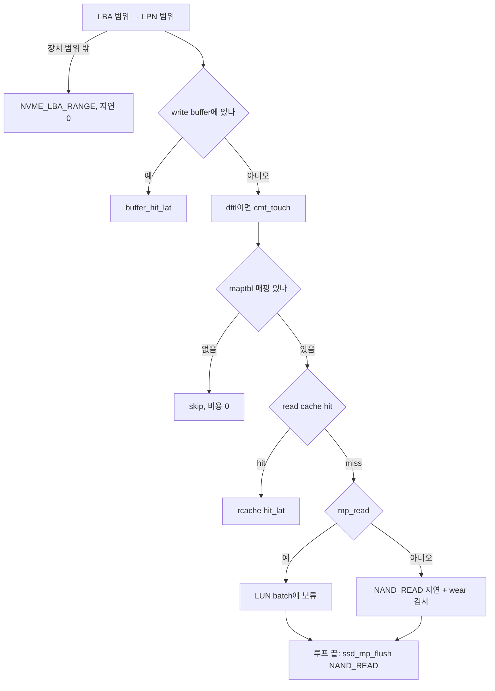

# 12. bbssd datapath — read · write · trim

기준: `study` 브랜치, 학습 주석이 들어간 뒤의 줄 번호.
대상 파일: [`ftl-datapath.c`](../../ftl-datapath.c) (host I/O 경로), [`ftl-cache.c`](../../ftl-cache.c) (DRAM read cache)

## 1. 개요

host I/O 요청은 poller가 FTL ring에 넣고, controller당 하나인 **FTL thread**가 꺼내서 처리한다.

```text
femu_ftl_thread()              (femu.c)
 ├ femu_ftl_process_req()      (femu.c)
 │  └ bb_ftl_process_req()     (ftl.c)   ← opcode로 분기
 │     └ ssd_read / ssd_write / ssd_write_zeroes / ssd_trim / ssd_buffer_destage
 └ req->expire_time += lat     ← poller는 expire_time 순 pqueue로 completion을 늦춘다
```

- handler의 반환값은 **지연(duration, ns)** 이다. 완료 시각이 아니다. 기준 시각은 요청 도착 시각 `req->stime`.
- write buffer, maptbl/rmap, line, NAND timeline은 FTL thread만 만진다. 그래서 이 파일에는 lock이 없다.
- handler가 끝나면 `bb_ftl_process_req()`가 background GC(non-FDP: `should_gc()` → `do_gc(ssd, false)`)를 확인한다.

| NVMe 명령 | non-FDP | FDP 모드 |
|---|---|---|
| Read | `ssd_read()` | `ssd_read()` (multi-plane read만 꺼짐) |
| Write | `ssd_write()` | `nvme_do_write_fdp()` ([ftl-fdp.c](../../ftl-fdp.c)) |
| Write Zeroes | `ssd_write_zeroes()` | `ssd_write_zeroes_fdp_style()` |
| DSM Deallocate | `ssd_trim()` | `ssd_trim_fdp_style()` |
| Flush | `ssd_buffer_destage(ssd, 0, stime)` | 동일 |
| Copy | `ssd_copy()` ([ftl.c](../../ftl.c)): range별 `ssd_read()` 후 `ssd_write()` | write만 `nvme_do_write_fdp()` |

## 2. 함수 표

### ftl-datapath.c

| 함수 | 역할 | 호출하는 곳 |
|---|---|---|
| [`ssd_read()`](../../ftl-datapath.c#L825) | LPN마다 buffer → (CMT) → maptbl → read cache → NAND | `bb_ftl_process_req()`, `ssd_copy()` |
| [`ssd_write()`](../../ftl-datapath.c#L926) | buffer 경로 또는 direct 경로로 write | `bb_ftl_process_req()`, `ssd_copy()` |
| [`ssd_write_zeroes()`](../../ftl-datapath.c#L1197) | DEAC면 unmap, 아니면 zero page program | `bb_ftl_process_req()` |
| [`ssd_trim()`](../../ftl-datapath.c#L1315) | DSM range마다 unmap | `bb_ftl_process_req()` |
| [`ssd_deallocate_lpns()`](../../ftl-datapath.c#L1128) | LPN 범위 unmap 공통 루틴 | `ssd_trim()`, `ssd_write_zeroes()`, `bbssd_deallocate_all()` |
| [`ssd_program_lpn()`](../../ftl-datapath.c#L621) | LPN 1개 out-of-place program | `ssd_write()`, `ssd_buffer_destage()`, `ssd_write_zeroes()` |
| [`ssd_buffer_destage()`](../../ftl-datapath.c#L746) | buffer → NAND (LRU 순) | `ssd_write()`, `bb_ftl_process_req()`(Flush), `bbssd_drain_namespace()`, `bbssd_flush_all()` |
| [`ssd_gc_until_clear()`](../../ftl-datapath.c#L710) | free line이 high 기준 이하인 동안 foreground GC | `ssd_write()`, `ssd_write_zeroes()`, `ssd_buffer_destage()` |
| [`ssd_mp_add()`](../../ftl-datapath.c#L557) · [`ssd_mp_charge()`](../../ftl-datapath.c#L526) · [`ssd_mp_flush()`](../../ftl-datapath.c#L587) | multi-plane batch 보류 · charge · 정리 | `ssd_read()`, `ssd_program_lpn()`, write 계열 끝부분 |
| [`ssd_read_check_wear()`](../../ftl-datapath.c#L434) | read disturb / retention 후보 등록 | `ssd_read()`, `ssd_mp_charge()` |
| [`buffer_enabled()`](../../ftl-datapath.c#L82) | buffer가 새 write를 받아도 되나 | `ssd_write()` |
| [`buffer_insert()`](../../ftl-datapath.c#L177) | entry 추가, 있으면 tail로 (write hit) | `ssd_write()` |
| [`buffer_discard()`](../../ftl-datapath.c#L208) | program 없이 entry 폐기 | `ssd_write()`, `ssd_write_zeroes()`, `ssd_deallocate_lpns()`, `bbssd_power_loss()` |
| [`buffer_select_victim()`](../../ftl-datapath.c#L147) | LRU 맨 앞 entry 꺼내기 | `ssd_buffer_destage()` |
| [`buffer_write_data()`](../../ftl-datapath.c#L291) | power_loss 모드: data 반영 + undo 저장 | `ssd_write()` |
| [`bbssd_drain_namespace()`](../../ftl-datapath.c#L338) | power_loss: 한 ns의 buffer 비우기 | `nvme_dsm()`, `nvme_copy()`, `nvme_write_zeros()`, `nvme_write_uncor()`, `nvme_format_namespace()` |
| [`bbssd_flush_all()`](../../ftl-datapath.c#L359) | power_loss: 모든 ns의 buffer 비우기 | `nvme_set_feature()`(VWC off), `nvme_sanitize()`, `nvme_write_bar()`(shutdown) |
| [`bbssd_power_loss()`](../../ftl-datapath.c#L383) | 전원 차단: undo로 되돌리고 buffer 폐기 | `femu_simulate_power_loss()` |
| [`bbssd_deallocate_all()`](../../ftl-datapath.c#L1293) | Format/Sanitize 때 전체 unmap | `nvme_sanitize()`, `nvme_format_namespace()` |

### ftl-cache.c

| 함수 | 역할 | 호출하는 곳 |
|---|---|---|
| [`rcache_init()`](../../ftl-cache.c#L312) | slot 배열 · hash 할당, `hit_lat` 결정 | `ssd_init()` |
| [`rcache_touch()`](../../ftl-cache.c#L185) | hit면 `hit_lat`, miss면 LPN 삽입 후 0 | `ssd_read()` |
| [`rcache_invalidate()`](../../ftl-cache.c#L248) | overwrite/trim된 LPN 제거 | `ssd_program_lpn()`, `ssd_deallocate_lpns()`, `bbssd_power_loss()`, FDP의 `ssd_stream_write_lpns()` · `ssd_deallocate_fdp_lpns()` |
| [`rcache_evict()`](../../ftl-cache.c#L157) | CLOCK / random / LRU / 2Q 중 victim 선택 | `rcache_touch()` |
| [`rcache_destroy()`](../../ftl-cache.c#L353) | 해제 | `ssd_free()` |

## 3. read 흐름 — `ssd_read()`



- 순서가 **buffer → CMT → maptbl → read cache → NAND** 이다. 아직 program 안 된 page는 maptbl에 없으므로 [buffer를 먼저](../../ftl-datapath.c#L854) 봐야 최신 버전을 기준으로 지연을 낸다.
- 매핑이 없는 LPN(쓴 적 없음, trim됨)은 NAND 비용이 0이다.
- 카운터 구분: `sp.read_cnt` · `sp.read_hit_cnt`는 buffer 통계, block의 `read_cnt`는 read disturb용이다. 후자는 실제 NAND read일 때만 `ssd_advance_status()`([ftl-media.c](../../ftl-media.c))에서 오르고 erase 때 0이 된다.
- [read cache](../../ftl-datapath.c#L887)는 매핑된 LPN에만 쓰인다. hit/miss는 `rcache.hits` · `rcache.misses`에 따로 센다.

## 4. write 흐름 — `ssd_write()`

공통 앞부분: LPN 범위 검사 → `should_gc_high()`인 동안 `do_gc(ssd, true)` → `do_read_reclaim()` → `host_write_pages` · `sp.write_cnt` 증가.
그 다음 [buffer 경로 조건](../../ftl-datapath.c#L983)에서 갈린다.

| 항목 | buffer 경로 | direct 경로 |
|---|---|---|
| 조건 | `buffer_enabled()` && FUA 아님 && stream 아님 && (power_loss면 `write_data` 있음) | 나머지 전부 (buffer 없음/꺼짐, FUA, Streams, power_loss의 Copy) |
| LPN 처리 | `buffer_insert()`, 이미 있으면 write hit | LPN마다 `ssd_gc_until_clear()` → 공간 확인 → `cmt_touch()` → `ssd_program_lpn()` |
| NAND program 시점 | 나중: watermark · Flush · drain 때 `ssd_buffer_destage()` | 지금 |
| 반환 지연 | max(destage 지연, `buffer_hit_lat()`) | page별 program 지연, CMT, reclaim의 max |
| 같은 LPN 재기록 | program 1회로 합쳐짐 (`sp.write_hit_cnt`++) | 매번 program, 옛 page invalid |
| buffer의 옛 버전 | tail로 옮기기만 | [먼저 폐기](../../ftl-datapath.c#L1033), cache off면 나머지도 전부 destage |
| 공간 부족 | destage 후에도 line이 없고 watermark면 `NVME_CAP_EXCEEDED` | `ssd_out_of_lines()`면 `NVME_CAP_EXCEEDED` |

watermark 예 (`buffer_size=100`, `buffer_thres_pcent=90`):

| 값 | 식 | 결과 |
|---|---|---|
| watermark | `(int)(100 × 0.90)` | 90 page |
| destage batch | 100 − 90 | 10 page |

점유가 90인데 새 LPN이 오면 가장 오래된 10 page를 program하고 넣는다. 그래서 점유는 81~90 page 사이를 오간다.

[`ssd_program_lpn()`](../../ftl-datapath.c#L621) 내부:

| 단계 | 하는 일 | scheme별 차이 |
|---|---|---|
| ① [prepare_write](../../ftl-datapath.c#L641) | 배치 class 결정 | page/dftl: DATA (`hot_cold_sep`이면 덮어쓰기는 HOT), hybrid/fast: LOG |
| — | `rcache_invalidate()` | |
| ② PPA 할당 | `get_new_page_class()` 또는 stream line | |
| ③ [commit_write](../../ftl-datapath.c#L656) | 옛 PPA invalid + maptbl/rmap 갱신 | 네 scheme 모두 같은 flat 갱신, hybrid/fast는 log 모델도 기록 |
| ④ write pointer 전진 | ch → LUN → plane → page 순, line 끝이면 다음 free line | |
| ⑤ 지연 | `ssd_advance_status()` 또는 [`ssd_mp_add()`](../../ftl-datapath.c#L678) | hybrid는 log가 차면 page마다 merge |

## 5. trim · write zeroes 흐름

| 경로 | 매핑 처리 | NAND 비용 | 반환 지연 |
|---|---|---|---|
| DSM Deallocate (`ssd_trim()`) | range마다 `ssd_deallocate_lpns()` | 없음 | `trim_lat_ns × nr_ranges` (기본 0) |
| Write Zeroes, [DEAC=0](../../ftl-datapath.c#L1209) | LPN마다 `ssd_program_lpn()` (buffer 안 거침) | page program | page별 지연의 max |
| Write Zeroes, DEAC=1 | `ssd_deallocate_lpns()` | 없음 | 0 |
| Format / Sanitize | `bbssd_deallocate_all()` | 없음 | (admin 경로) |

[`ssd_deallocate_lpns()`](../../ftl-datapath.c#L1128)는 순서가 핵심이다.

1. [`buffer_discard()`](../../ftl-datapath.c#L1146) **먼저**: buffer에만 있는 page는 maptbl에 매핑이 없어서, 매핑 검사를 먼저 하면 `continue`로 빠지고 버려진 data가 나중에 program된다.
2. 매핑이 있으면 `mapping->trim()`(hybrid/fast) 또는 flat unmap(page/dftl: page invalid, rmap = `INVALID_LPN`, maptbl = `UNMAPPED_PPA`).
3. `rcache_invalidate()`.

- backend를 0으로 채우고 util bit를 맞추는 일은 I/O layer(`nvme_dsm()`, `nvme_write_zeros()`)가 이미 끝낸 상태다. FTL은 매핑과 지연만 책임진다.
- DSM range 배열 `req->dsm_ranges`는 `nvme_dsm()`이 만들고 `ssd_trim()`이 `g_free()` 한다.
- Write Zeroes의 NLB 필드는 0-based라 `+ 1`, DSM range의 `nlb`는 개수 그대로 쓴다.

## 6. 지연(latency) 계산 방식

| 원칙 | 설명 | 코드 |
|---|---|---|
| 기준 시각 | 한 요청의 모든 page는 같은 `req->stime`에 발행된 것으로 본다 | `srd.stime = req->stime` |
| page 지연 | `done − stime`, `done = max(stime, LUN 가용 시각) + array 시간` (bus 단계 옵션이 없을 때) | `nand_media_op()` ([nand-media.c](../../../nand/nand-media.c)) |
| 요청 지연 | page 지연의 **max** (합이 아님) | `maxlat = (sublat > maxlat) ? …` |
| 병렬성 | 다른 LUN은 겹쳐 진행, 같은 LUN은 LUN 가용 시각에서 줄을 선다 | ftl-media.c |
| CMT (dftl) | translation page 비용도 같은 stime 기준이라 data 지연과 max | `cmt_touch()` ([ftl-map-cmt.c](../../ftl-map-cmt.c)) |
| GC | foreground GC 비용은 반환값에 없다. GC의 NAND op가 LUN 가용 시각을 밀어서 뒤 page 지연이 커진다 (`enable_gc_delay`, 기본 true) | [`ssd_gc_until_clear()`](../../ftl-datapath.c#L710) |
| Copy | `max(read 지연) + write 지연` (read가 끝나야 write) | `ssd_copy()` |
| DRAM 접근 | buffer: `buffer_hit_lat()`가 매번 `pg_rd_lat/16` 계산, read cache: `rcache_init()` 때 한 번 계산 | |

multi-plane (`mp_program` / `mp_read`, `pls_per_lun > 1`일 때만 켜짐):

- LUN마다 batch(`mp_prog`, `mp_rd`)에 **같은 stime · 같은 ch/LUN/blk/pg · 다른 plane**인 page를 모은다 ([`ssd_mp_fits()`](../../ftl-datapath.c#L501)).
- write pointer가 ch → LUN → plane → page 순서라, 연속 write에서 같은 LUN의 plane 0, 1, …이 `nchs × luns_per_ch` page 간격으로 나와 batch가 된다.
- charge 시점: plane 수만큼 찼을 때, 안 맞는 page가 왔을 때, 요청 끝 · GC 직전 · hybrid merge 직전의 `ssd_mp_flush()`.
- `ssd_advance_status_multiplane()`: plane별 command/data 단계는 channel에서 차례로, array 동작은 **한 번**만 계산한다.
- 보류만 한 경우 `ssd_mp_add()`는 0을 돌려줄 수 있다. 실제 비용은 flush 때 max에 들어간다.
- FDP 모드에서는 `ssd_mp_reads()`가 false라 multi-plane read를 쓰지 않는다.

## 7. 옵션 표 — write buffer · read cache · 관련

기본값은 [femu.c](../../../femu.c)의 `DEFINE_PROP_*`, `ssd->sp`로의 반영은 `ssd_init_params()`([ftl-geom.c](../../ftl-geom.c)).

| 파라미터 | 의미 | 기본값 | 반영 · 사용 위치 |
|---|---|---|---|
| `buffer_size` | write buffer 크기(page 수). 0이면 buffer 없음 | 0 | `sp.buffer_size`, `ssd_init_write_pointer()`가 `wb_tree` 생성 |
| `buffer_thres_pcent` | watermark 비율(%), 1~100 | 90 | `sp.buffer_thres_pcent = 값/100.0`, 범위 검사 `bb_check_geometry()` |
| `vwc` | Volatile Write Cache 광고. 1이면 host가 Set Features로 끌 수 있다 | 0 | `features.volatile_wc = vwc` (`nvme_reset_features()`) |
| `power_loss` | data를 FTL thread에서 다루고 undo log로 전원 차단을 흉내. bbssd + `buffer_size > 0` 필요, ns_mgmt/subsys/meta/pi 불가 | false | `nvme_check_constraints()` |
| `read_cache_mb` | read cache 크기(MiB). 0이면 꺼짐 | 0 | `rcache_init()` |
| `cache_evict` | `random` / `lru` / `arc`(실제로는 2Q 방식), 그 외 CLOCK | 미지정 = CLOCK | `ssd_init()` ([ftl.c](../../ftl.c)) |
| `mp_program` / `mp_read` | multi-plane program / read | 0 / 0 | `sp.mp_* = 값 && pls_per_lun > 1` |
| `trim_lat_ns` | DSM range 하나당 지연(ns) | 0 | `ssd_trim()` |
| `hot_cold_sep` | 덮어쓰기 LPN을 HOT class line에 | false | page/dftl `prepare_write` |
| `read_reclaim_limit` / `retention_limit_sec` | read 횟수 / 보존 시간 한도, 0이면 끔 | 0 / 0 | `ssd_read_check_wear()` |
| `pg_rd_lat` | page read 시간(ns), DRAM hit 지연의 기준 | 40000 | hit 지연 = 40000/16 = 2500ns |

power_loss · vwc · buffer 조합 (`buffer_size > 0` 가정):

| power_loss | vwc | host의 VWC 설정 | buffer가 write를 받나 |
|---|---|---|---|
| off | 0 | — | 받음 |
| off | 1 | 켬 (reset 기본값) | 받음 |
| off | 1 | 끔 | 안 받음, 남은 page는 다음 direct write나 Flush에서 drain |
| on | 0 | — | 안 받음 (모든 write direct) |
| on | 1 | 켬 | 받음 (data가 있는 Write만) |

## 8. 공부 포인트 · 확인 질문

공부 포인트

1. 반환값은 "지연"이다. `femu_ftl_thread()`에서 `expire_time`에 더해지는 곳까지 따라가 보자.
2. read도 deallocate도 **buffer를 maptbl보다 먼저** 본다. 왜 그래야 하는지 설명할 수 있어야 한다.
3. `ssd_gc_until_clear()`를 page마다 부르는 이유: 한 명령이 watermark가 남겨 둔 것보다 많은 line을 쓸 수 있다.
4. FUA와 Streams write는 왜 buffer를 건너뛰나 (FUA: 완료 전에 media에 있어야 함).
5. power_loss의 undo log: entry가 사라지는 순간이 곧 "durable 확정"이다.

확인 질문

| # | 질문 | 힌트 |
|---|---|---|
| Q1 | 서로 다른 8개 LUN에 1 page씩 쓰는 write의 지연은 1 page 지연과 비교해 어떤가? | max 원칙 |
| Q2 | buffer 경로로 같은 LPN을 10번 쓰면 program은 몇 번? `write_hit_cnt`는? | `buffer_insert()` |
| Q3 | buffer에만 있는 LPN을 trim하면? `buffer_discard()`가 매핑 검사 뒤에 있었다면? | `ssd_deallocate_lpns()` |
| Q4 | `mp_program=1`, `pls_per_lun=2`, `nchs × luns_per_ch = 8`에서 빈 line에 16 page를 순서대로 쓰면 batch는 몇 개? | write pointer 순서 |
| Q5 | read cache `hit_lat`가 0이면 무엇이 깨지나? | `rcache_touch()` 반환 규약 |
| Q6 | trim 지연이 기본 0인데도 GC에는 어떤 이득을 주나? | invalid page와 victim 선택 |
| Q7 | dftl에서 CMT miss 비용과 data read 비용은 왜 더해지지 않고 max로 합쳐지나? | 둘 다 `req->stime` 기준 |

## 9. 코드에서 눈에 띈 점 (수정하지 않음)

- Write Zeroes(DEAC=0) 경로는 `ssd_write()`와 달리 `cmt_touch()`(dftl 비용), `do_read_reclaim()`, 요청당 reclaim(fast)을 하지 않는다.
- `ssd_trim()`은 장치 범위 밖 range를 에러 없이 건너뛰고, `trim_lat_ns`는 건너뛴 range까지 센다.
- `cache_evict=arc`는 이름과 달리 ARC가 아니라 2Q 방식(policy 3)이다.
- read cache `hit_lat`는 init 때 고정, buffer hit 지연은 매번 `pg_rd_lat`에서 계산한다. 런타임에 delay emulation을 끄면(`pg_rd_lat = 0`, [bb.c](../../bb.c)) buffer hit은 1000ns, read cache hit은 init 때 값 그대로라 NAND read(0)보다 비싸진다.
