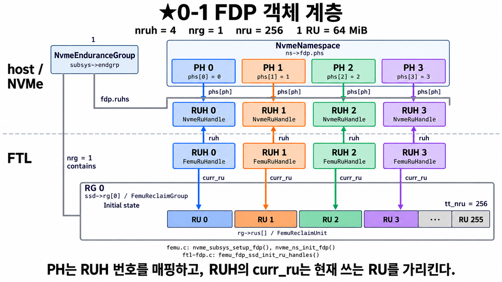
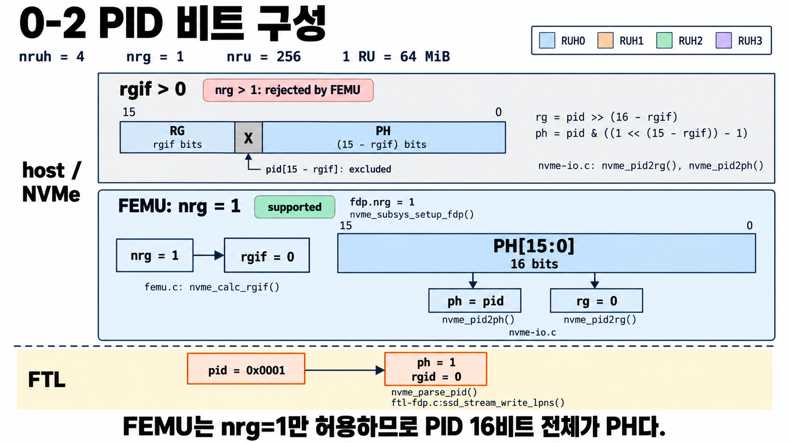

# FDP 0단계 — 큰 그림: RU, RUH, PH가 뭐야?

코드를 읽기 전에 그림 두 장으로 FDP의 등장인물을 익힌다.

## 0-1 RU, RUH, PH의 관계

---

**나:** 그림에 상자가 너무 많아요. 어디부터 봐요?

**선배:** 맨 아래 줄부터 보자. `RU 0, RU 1, … RU 255`라고 적힌 칸들.
**RU(Reclaim Unit)** 는 SSD가 **한 번에 통째로 지우는 큰 칸**이야.
FEMU 기본 설정에서는 RU 하나가 64 MiB이고, 256개가 있어.

**나:** 왜 "통째로 지우는" 단위가 중요해요?

**선배:** SSD는 이미 쓴 자리에 덮어쓰지 못해. 데이터를 고치면 새 자리에 쓰고,
옛 자리는 "버린 데이터"로 표시만 해. 나중에 공간이 모자라면 **GC**가
RU 하나를 골라서 아직 살아 있는 데이터만 다른 곳으로 옮기고 RU를 지워.
이때 **옮기는 양이 적을수록** SSD가 덜 일하고 수명도 길어져.

**나:** 그럼 옮길 게 적으려면요?

**선배:** **같이 버려질 데이터끼리 같은 RU에 모아 두면** 돼.
예를 들어 자주 바뀌는 데이터(hot)와 거의 안 바뀌는 데이터(cold)를 따로 모으면,
hot RU는 금방 거의 다 "버린 데이터"가 돼서 옮길 게 별로 없어.
**FDP는 host가 SSD에게 "이 데이터는 이 묶음에 넣어 줘"라고 알려 주는 기능**이야.

> 비유: 과목별 공책. 같은 과목 필기는 같은 공책에 쓴다.
> 학기가 끝나면 그 과목 공책을 통째로 버리면 되니까 다른 과목 페이지를 옮겨 적을 필요가 없다.
> 공책 한 권 = RU.

---

**나:** 그 위에 있는 `RUH 0~3`은요?

**선배:** **RUH(Reclaim Unit Handle)** 는 "이 묶음 데이터는 **지금 이 RU에** 쓰는 중"이라고
가리키는 **손가락**이야. 그림에서 `curr_ru` 화살표가 그 손가락이고,
RUH 0은 RU 0을, RUH 1은 RU 1을 가리키고 있지(처음 상태).
RUH가 4개니까 **데이터를 4갈래로 나눠 담을 수 있어.** 색이 4개인 이유야.

> 공책 비유로는 "과목마다 지금 펼쳐 둔 공책". 공책을 다 쓰면 새 공책을 펼친다
> (= RU가 가득 차면 RUH가 빈 RU를 새로 받는다. 4단계에서 자세히).

**나:** 그런데 RUH가 왜 두 줄이에요? `NvmeRuHandle`이랑 `FemuRuHandle`.

**선배:** 가운데 **점선**을 봐. 점선 위는 **host가 볼 수 있는 세계(NVMe 층)**,
아래는 **SSD 내부(FTL 층)** 야. 같은 RUH 하나를 두 층에서 각자 관리해.

| | 위: `NvmeRuHandle` | 아래: `FemuRuHandle` |
|---|---|---|
| 하는 일 | host에게 보고할 정보 (남은 공간 등) | 실제로 어느 RU의 어느 page에 쓸지 결정 |
| 비유 | 안내판 | 실제 공책을 쥔 손 |

둘은 `ruh` 화살표로 연결돼 있어서 같은 RUH라는 걸 알 수 있어.

---

**나:** 맨 위 `PH 0~3`은요?

**선배:** **PH(Placement Handle)** 는 host가 부르는 **번호표**야.
host는 "RUH 2번"이라고 직접 말하지 않고 "**PH 2번**에 써 줘"라고 말해.
그러면 namespace(host가 보는 디스크)의 `phs` 표가 PH 번호를 RUH 번호로 바꿔 줘.

**나:** 그림 보면 `phs[0] = 0`, `phs[1] = 1` … 그냥 같은 번호네요?

**선배:** 맞아. **FEMU에서는 PH 번호 = RUH 번호**로 고정돼 있어.
실제 SSD는 namespace마다 다르게 연결할 수도 있어서 표가 따로 있는 거야.
우리 과제(파일시스템이 PH를 골라 보내기)에서는 "PH = RUH"라고 생각해도 돼.

**나:** 왼쪽 `NvmeEnduranceGroup`이랑 `RG 0`은요?

**선배:** **RG(Reclaim Group)** 는 RU들을 묶은 그룹인데, FEMU는 **1개만** 쓸 수 있어.
그래서 지금은 "RU 256개가 한 그룹에 다 들어 있다" 정도만 알면 충분해.
Endurance Group은 FDP 설정 전체를 담는 큰 상자라고 보면 돼.
(그림의 "contains" 선은 단순화한 거야. 실제로는 NVMe 층과 FTL 층에 RU 정보가 따로 있어.)

---

## 0-2 PID 안에는 뭐가 들어 있나

**나:** host가 보내는 번호는 PH라고 했는데, 그림에는 PID라고 써 있어요.

**선배:** host가 write에 실어 보내는 16비트 숫자를 **PID(Placement ID)** 라고 해.
원래 규격에서는 이 16비트를 **둘로 쪼개서** 앞쪽은 RG 번호, 뒤쪽은 PH 번호로 써(위 회색 상자).
RG가 여러 개인 SSD라면 "몇 번 그룹의 몇 번 묶음"을 한 숫자로 말하는 셈이야.

**나:** 위 상자에 빨간 글씨로 "rejected by FEMU"라고 되어 있네요.

**선배:** FEMU는 **RG를 1개만** 허용해(`fdp.nrg=1`). RG가 하나뿐이면 RG 번호에 비트를 쓸 필요가 없지?
그래서 RG 비트 수(`rgif`)가 0이 되고, **16비트 전체가 PH**가 돼(가운데 초록 "supported" 상자).

> 정리: **FEMU에서는 PID = PH.** host가 DSPEC에 1을 넣으면 그대로 PH 1이다.
> 맨 아래 노란 칸의 예: `pid = 0x0001` → `ph = 1`, `rgid = 0`.

(참고: 위 회색 상자의 X 칸은, RG가 여러 개일 때 FEMU 코드가 비트 하나를 빼고 PH를 꺼내는 부분이다.
FEMU에서는 쓰이지 않는 경로라 지금은 신경 쓰지 않아도 된다.)

---

## 한 줄 정리

> host는 **PH 번호**로 말하고 → SSD는 그걸 **RUH**로 바꾸고 → RUH가 가리키는 **RU**에 쓴다.
> 같은 RUH의 데이터는 같은 RU에 모이니까, GC 때 옮길 게 줄어든다.

## 확인 질문

1. RUH가 4개면 데이터를 몇 갈래로 나눌 수 있나?
2. RU 하나가 가득 차면 RUH는 어떻게 되나?
3. host가 PH 3번에 쓰라고 하면, FEMU에서는 어느 RUH로 가나?

답

1. 4갈래. RUH마다 자기 RU를 따로 들고 있다.
2. 빈 RU를 새로 받아서 손가락(`curr_ru`)을 옮긴다.
3. RUH 3. FEMU는 `phs[i] = i`라서 PH 번호와 RUH 번호가 같다.

## 나중에 코드에서 찾아보기

| 그림의 것 | 코드 |
|---|---|
| RUH·RU를 만드는 곳 | [`nvme_subsys_setup_fdp()`](../../../femu.c#L98) |
| `phs` 표를 만드는 곳 | [`nvme_ns_init_fdp()`](../../../femu.c#L343) |
| FTL 층 RUH가 처음 RU를 받는 곳 | [`femu_fdp_ssd_init_ru_handles()`](../../ftl-fdp.c#L1903) |
