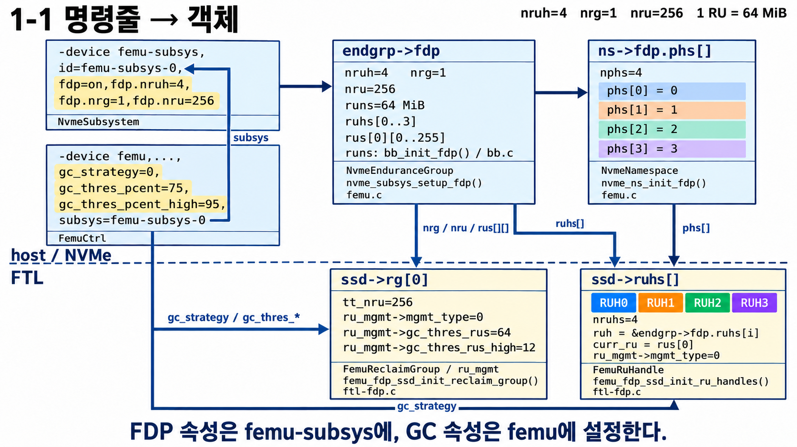
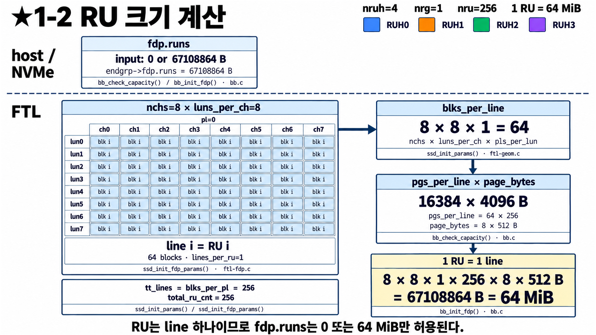
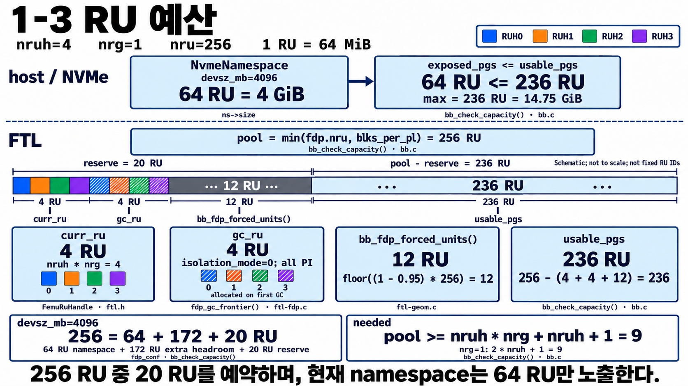
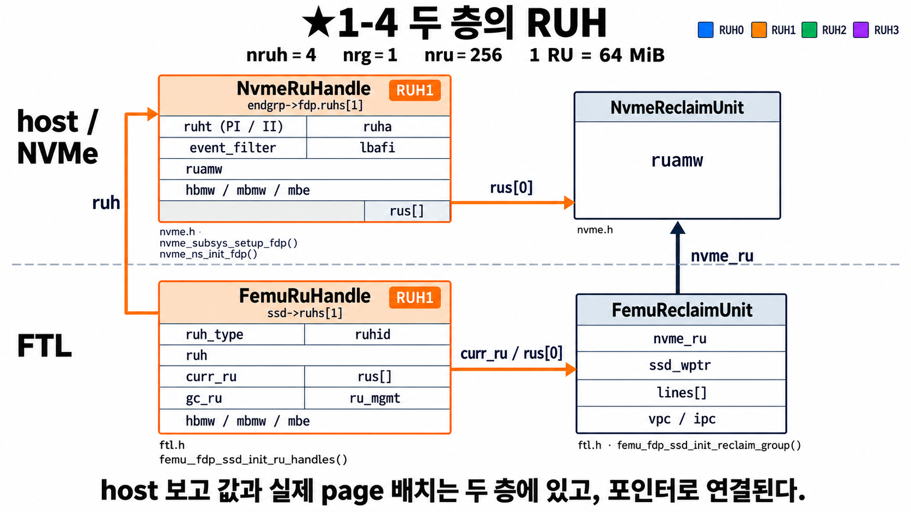

# FDP 1단계 — 파라미터: RUH 몇 개, RU 얼마나 크게?

[0단계](30_FDP_0단계_큰그림.md)에서 RU·RUH·PH가 뭔지 봤다.
이번에는 **FEMU를 띄울 때 이 숫자들을 어떻게 정하는지**, 정한 숫자가 어디에 들어가는지 본다.
그림 4장: 명령줄 → 객체, RU 크기, RU 예산, 두 층의 RUH.

---

## 1-1 명령줄의 옵션은 어디로 가나

**나:** FDP는 어떻게 켜요?

**선배:** QEMU를 실행할 때 장치를 **두 개** 만들어. 왼쪽 위 두 상자야.

| 장치 | 맡는 것 | 이 그림의 옵션 |
|---|---|---|
| `femu-subsys` | **FDP 설정** | `fdp=on`, `fdp.nruh=4`, `fdp.nrg=1`, `fdp.nru=256` |
| `femu` | **SSD 본체와 GC 설정** | `gc_strategy=0`, `gc_thres_pcent=75`, `gc_thres_pcent_high=95` |

`femu` 쪽의 `subsys=femu-subsys-0`이 둘을 이어 줘(그림의 `subsys` 화살표).

**나:** 왜 굳이 둘로 나눠요?

**선배:** NVMe 규격에서 FDP는 SSD 한 대가 아니라 **subsystem(정확히는 Endurance Group)의 속성**이라서 그래.
그래서 `fdp.nruh` 같은 옵션을 `femu`에 넣으면 "그런 속성 없음" 에러가 나.
처음 설정할 때 제일 많이 하는 실수야. 그리고 명령줄에서 **subsys를 먼저** 적어야 해.

**나:** 화살표를 따라가면요?

**선배:** 위에서 아래로, **설계도 → 실제 배치** 순서야.

1. FDP 옵션 → **`endgrp->fdp`**: RUH 4개(`ruhs[0..3]`), RU 256개(`rus[0][0..255]`), RU 크기 64 MiB
2. → **`ns->fdp.phs[]`**: namespace의 PH 번호표. `phs[i] = i` (0단계에서 본 것)
3. 점선 아래로 내려가서 FTL이 실제로 쓸 것을 만들어:
   - **`ssd->rg[0]`**: RU 256개를 관리. GC 정책(`mgmt_type=0` = greedy)과 GC 기준(`gc_thres_rus=64`, `_high=12`)
   - **`ssd->ruhs[]`**: RUH 4개. 각각 처음 쓸 RU(`curr_ru`)를 하나씩 받음
4. `femu`의 GC 옵션은 아래쪽 화살표로 FTL 상자에 바로 들어가.

> 그림 아래 한 줄이 핵심: **FDP 속성은 `femu-subsys`에, GC 속성은 `femu`에.**

---

## 1-2 RU 하나는 왜 64 MiB인가

**나:** RU 크기는 마음대로 못 정해요?

**선배:** FEMU에서는 **RU = line(superblock) 1개**로 고정이야. 왼쪽 격자를 봐.
8 channel × 8 LUN, 칸마다 `blk i`라고 적혀 있지? **64개 칩 모두에서 같은 번호 i의 block을 묶은 것**이
line i이고, 그게 RU i야.

**나:** 왜 칩마다 하나씩 묶어요?

**선배:** 한 칩에 몰아 쓰면 느리니까, **64개 칩에 돌아가며 동시에** 쓰려고.
그래서 RU 하나를 채우면 모든 칩을 골고루 쓰게 돼.

**나:** 계산은요?

**선배:** 오른쪽 상자 순서대로.

| 단계 | 계산 | 값 |
|---|---|---|
| line 하나의 block 수 | 8 ch × 8 LUN × 1 plane | 64 block |
| line 하나의 page 수 | 64 block × 256 page | 16,384 page |
| page 크기 | 8 sector × 512 B | 4 KiB |
| **RU 크기** | 16,384 × 4 KiB | **64 MiB** |

RU 개수는 line 개수 = `blks_per_pl` = **256개**.

**나:** 그럼 `fdp.runs` 옵션은요?

**선배:** **0(자동) 아니면 정확히 64 MiB**만 받아 줘. 다른 값은 "RU는 line 하나여야 한다"며 거부해.
RU 크기를 바꾸고 싶으면 `fdp.runs`가 아니라 **geometry(channel, LUN, page 수)** 를 바꿔야 해.

---

## 1-3 RU 256개는 어디에 쓰이나

**나:** RU가 256개면 전부 데이터 저장에 써요?

**선배:** 아니. 가운데 긴 막대를 봐. 왼쪽 **20개는 미리 떼어 두는 예약분**이야.

| 예약 | 개수 | 왜 필요해? |
|---|---|---|
| `curr_ru` | 4 | RUH마다 **지금 쓰고 있는 RU** 하나씩 |
| `gc_ru` | 4 | RUH마다 **GC가 옮길 데이터를 받는 RU** 하나씩 (PI라서. 5단계). 첫 GC 때 받음 |
| 강제 GC 여유 | 12 | free RU가 이만큼(5%) 남으면 강제 GC가 돌기 시작. 그 아래로는 안 내려가게 |

남는 **236개(약 14.75 GiB)** 까지 host에게 디스크 용량으로 보여 줄 수 있어.

**나:** 위에 `devsz_mb=4096`, `64 RU = 4 GiB`는요?

**선배:** 지금 설정은 디스크를 **4 GiB(RU 64개 분량)** 만 보여 줘. `64 ≤ 236`이니까 통과.
맨 아래 식 `256 = 64 + 172 + 20`처럼, 나머지 **172개는 여유 공간**이라 GC가 넉넉하게 일할 수 있어.
`devsz_mb`를 236 RU보다 크게 잡으면 FEMU가 실행을 거부해.

**나:** 오른쪽 아래 `pool ≥ 9`는요?

**선배:** 최소 조건이야. RUH 4개면 `열린 RU 4 + GC용 4 + 1 = 9`개는 있어야 돌아가.
RUH를 늘리면 예약분이 늘어서 쓸 수 있는 공간이 줄어든다는 것도 기억해 둬.

---

## 1-4 같은 RUH, 두 개의 얼굴

**나:** 0단계에서 RUH가 두 줄이었던 거, 여기서 자세히 나오네요.

**선배:** 응. 이번엔 **RUH 1 하나만** 확대했어. 점선 위가 host에게 보이는 쪽, 아래가 SSD 내부.

| | 위: `NvmeRuHandle` (NVMe 층) | 아래: `FemuRuHandle` (FTL 층) |
|---|---|---|
| 역할 | host에게 **보고**할 값 | 실제로 **어디에 쓸지** 결정 |
| 주요 칸 | `ruht`(PI/II 종류), `ruamw`(남은 공간), `event_filter`(기록할 event), `hbmw/mbmw/mbe`(쓴 양·지운 양) | `curr_ru`(지금 RU), `gc_ru`(GC용 RU), `ru_mgmt`(GC 관리), `ruhid` |
| 가리키는 RU | `NvmeReclaimUnit`: `ruamw`만 있는 간단한 상자 | `FemuReclaimUnit`: write pointer, line, valid/invalid page 수 |

**나:** 두 층이 어떻게 연결돼요?

**선배:** 화살표 두 개.
- 왼쪽 `ruh`: FTL의 RUH → NVMe의 RUH
- 오른쪽 `nvme_ru`: FTL의 RU → NVMe의 RU

그래서 FTL이 page를 쓰면서 **NVMe 쪽 숫자(남은 공간 등)도 같이 갱신**할 수 있어.
host가 `nvme fdp status`로 보는 RUAMW는 **위쪽 NVMe 층** 값이야.

**나:** RU가 바뀌면 둘 다 바꿔야겠네요?

**선배:** 맞아. 그래서 RU를 교체하는 코드는 항상 **FTL 쪽 `curr_ru`와 NVMe 쪽 `rus[]`를 같이** 바꿔.
3단계 RUH Update 그림의 마지막 칸이 바로 그거야.

---

## 한 줄 정리

> FDP 옵션은 `femu-subsys`, GC 옵션은 `femu`에. RU = line 1개 = 64 MiB, 256개 중 20개는 예약.
> 같은 RUH가 host용(NVMe 층)과 실제 배치용(FTL 층) 두 벌로 있고 포인터로 연결된다.

## 확인 질문

1. `fdp.nruh=4`를 `femu` 쪽 옵션에 쓰면 어떻게 되나?
2. `luns_per_ch`를 4로 줄이면 RU 크기는?
3. `fdp.nruh=8`이면 예약 RU는 몇 개인가? (`isolation_mode=0`, 나머지 그대로)
4. host가 보는 RUAMW는 어느 층의 값인가?

답

1. 속성을 찾을 수 없다는 에러로 실행이 안 된다. FDP 속성은 `femu-subsys`에 있다.
2. 8 × 4 × 1 × 256 page × 4 KiB = 32 MiB.
3. 열린 RU 8 + GC용 8 + 강제 GC 여유 12 = 28개. 쓸 수 있는 RU는 228개.
4. NVMe 층(`NvmeReclaimUnit` / `NvmeRuHandle`).

## 나중에 코드에서 찾아보기

| 그림의 것 | 코드 |
|---|---|
| subsys 옵션 정의 | [femu.c `nvme_subsystem_props`](../../../femu.c#L273) |
| `endgrp->fdp` 만들기 | [`nvme_subsys_setup_fdp()`](../../../femu.c#L98) |
| RU 크기·예산 검사 | [`bb_check_capacity()`](../../bb.c#L43) |
| FTL 쪽 RG·RUH 만들기 | [`femu_fdp_ssd_init_reclaim_group()`](../../ftl-fdp.c#L1824), [`femu_fdp_ssd_init_ru_handles()`](../../ftl-fdp.c#L1903) |
| 두 층 구조체 | [ftl.h `struct FemuRuHandle`](../../ftl.h) |
