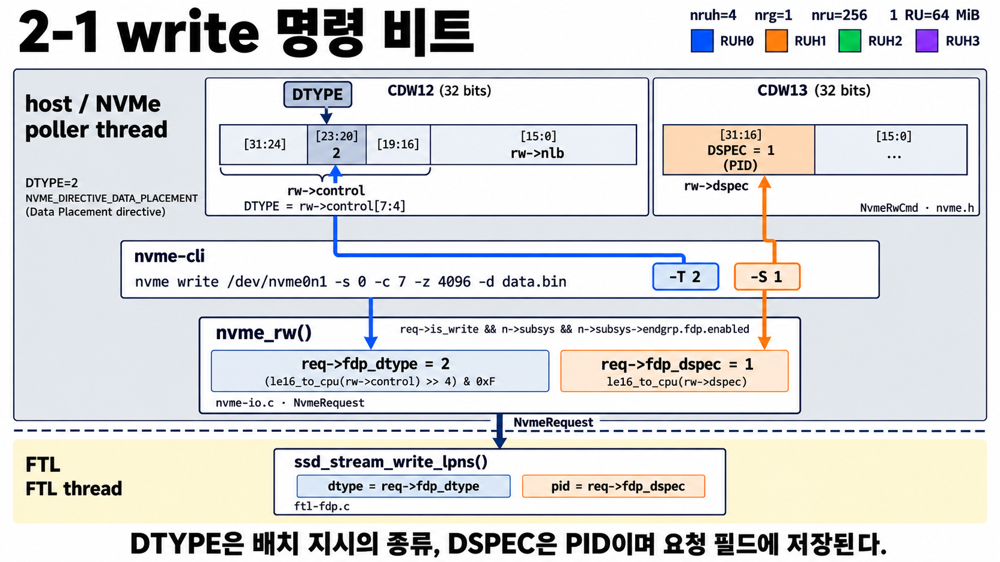
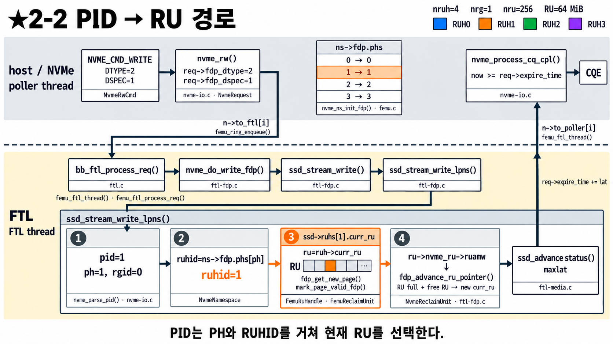
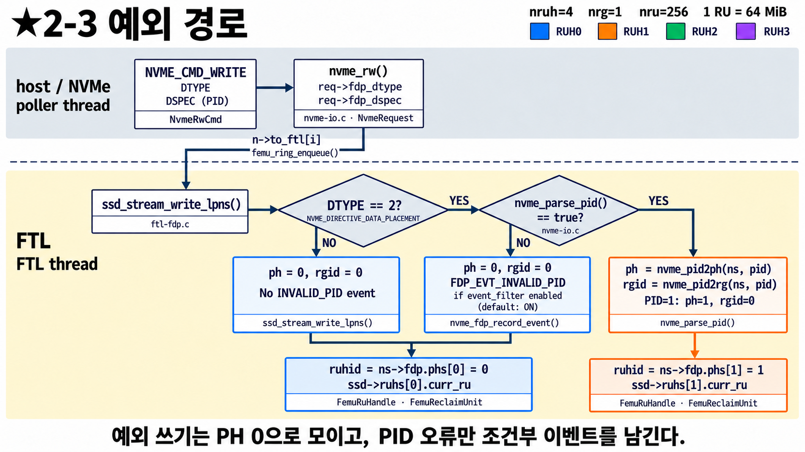
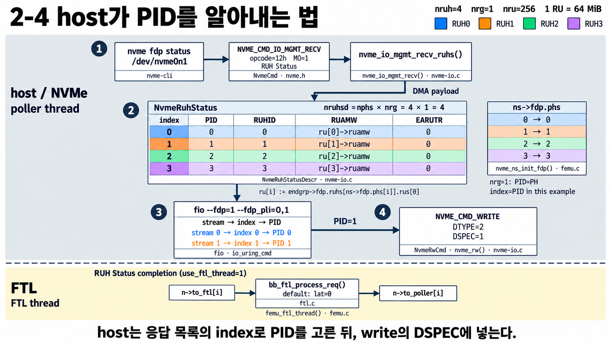

# FDP 2단계 — write 하나가 RU에 닿기까지

[0단계](30_FDP_0단계_큰그림.md)에서 PH → RUH → RU 관계를 봤다.
이번에는 **실제 write 명령 하나**가 FEMU 안에서 어떤 길을 따라 RU까지 가는지 본다.
그림 4장: 명령 안의 두 숫자 → 전체 경로 → 예외 경로 → host가 PID를 알아내는 법.

---

## 2-1 write 명령 안의 두 숫자

**나:** FDP write는 일반 write랑 뭐가 달라요?

**선배:** write 명령에 **숫자 두 개**가 더 들어가. 명령어로 치면 `nvme write ... -T 2 -S 1`.

| 이름 | nvme-cli | 값 | 뜻 | 명령 안의 위치 |
|---|---|---|---|---|
| DTYPE | `-T` | 2 | "이 write에는 **배치 정보가 있어**" 표시 | CDW12의 [23:20] 비트 |
| DSPEC | `-S` | 1 | "**PID 1번** 묶음으로 넣어 줘" | CDW13의 [31:16] 비트 |

**나:** CDW12, CDW13은 뭐예요?

**선배:** NVMe 명령은 32비트짜리 칸(CDW, Command Dword)을 여러 개 이어 붙인 거야.
그림 위쪽 두 막대가 그 칸이고, 색칠된 부분에 두 숫자가 들어가. CDW12의 아래쪽 `[15:0]`에는
원래 있던 "몇 블록 쓸지"(`nlb`)가 들어 있어. FDP 정보는 남는 비트에 끼워 넣는 거야.

**나:** 그다음은요?

**선배:** 접수 창구의 `nvme_rw()`가 두 숫자를 꺼내서 요청서에 적어 둬:
`req->fdp_dtype = 2`, `req->fdp_dspec = 1`. 점선 아래 FTL은 이 요청서를 보고 일해.
**PID**는 host가 보내는 묶음 번호고, FEMU에서는 **PID = PH**야(0-2 그림).

---

## 2-2 전체 경로

**나:** 이번 그림은 화살표가 길어요.

**선배:** 2-1의 write 명령이 **왼쪽 위에서 출발해서 아래로 내려갔다가, 오른쪽 위로 올라와 끝나.**
먼저 회색 칸과 노란 칸부터 구분하자. FEMU 안에서 일하는 사람이 둘이야.

| 칸 | 누구 | 하는 일 | 비유 |
|---|---|---|---|
| 위 회색 | **poller thread** | 명령을 받고, 끝나면 host에게 "완료" 알림 | 접수 창구 |
| 아래 노랑 | **FTL thread** | SSD 내부에서 실제로 어디에 쓸지 정하고 시간 계산 | 창고 일꾼 |

둘을 나눠 두면 창구는 일꾼을 기다리지 않고 다음 명령을 바로 받을 수 있어.

**나:** 순서대로 따라가 볼게요.

**선배:** 응.

1. **접수** — `nvme_rw()`가 DTYPE, DSPEC을 요청서에 적음 (2-1).
2. **일꾼에게 넘기기** — 요청서를 `to_ftl`이라는 **컨베이어 벨트**에 올려.
   점선을 건너 아래로 내려가는 화살표가 이거야.
3. **일꾼이 받음** — `bb_ftl_process_req()`가 "write구나, FDP가 켜져 있네" 하고
   FDP 전용 쓰기 함수로 넘겨. `nvme_do_write_fdp()` → `ssd_stream_write()` →
   `ssd_stream_write_lpns()`. 이름이 길지만 **"FDP 방식으로 써라"** 를 점점 자세히 하는 단계일 뿐이야.

**나:** 아래 큰 상자 안의 ①②③④가 핵심이죠?

**선배:** 맞아. 여기가 이번 단계의 주인공이야.

| 번호 | 하는 일 | 이 예시에서 |
|---|---|---|
| ① | PID를 쪼개서 RG 번호와 PH 번호를 얻음 | PID 1 → **PH 1**, RG 0 |
| ② | `phs` 표로 PH를 RUH 번호로 바꿈 (위 가운데 표) | PH 1 → **RUH 1** |
| ③ | RUH 1이 지금 들고 있는 RU(`curr_ru`)에서 빈 page 하나를 받아 씀 | 주황 RU의 칸 하나 |
| ④ | RU의 남은 공간(RUAMW)을 줄이고, RU가 꽉 찼으면 새 RU로 교체 | |

데이터가 여러 page면 ③④를 page마다 반복해.

> 0단계 공책 비유로: ① 학생이 말한 과목 번호를 듣고 → ② 번호표로 과목 칸을 찾고 →
> ③ 그 과목의 펼쳐 둔 공책 빈 줄에 쓰고 → ④ 공책이 다 차면 새 공책을 편다.

**나:** 오른쪽 `ssd_advance_status()`랑 `maxlat`은요?

**선배:** FEMU는 진짜 SSD처럼 **"쓰는 데 시간이 걸리는 척"** 을 해야 해.
page 하나 쓸 때마다 NAND가 얼마나 걸릴지 계산하고, 그중 **가장 늦게 끝나는 시간(maxlat)** 을
이 write 전체의 시간으로 정해.

**나:** 그다음 위로 올라가는 화살표는요?

**선배:** 일꾼이 요청서에 "이 시각에 끝남"(`expire_time`)을 적어서
`to_poller` 벨트로 창구에 돌려보내. 창구(`nvme_process_cq_cpl()`)는
**그 시각이 될 때까지 기다렸다가** host에게 완료(CQE)를 알려. 그래서 host 입장에서는
진짜 SSD처럼 시간이 걸린 것으로 보여.

---

## 2-3 예외 경로: 배치 정보가 없거나 틀리면

**나:** DSPEC에 엉뚱한 번호(예: 99)를 넣거나, 아예 안 넣으면요?

**선배:** 노란 칸의 마름모 두 개가 갈림길이야. 왼쪽부터.

| 갈림길 | 아니오(NO)면 | 결과 |
|---|---|---|
| `DTYPE == 2?` | 배치 정보가 없는 **일반 write** | **PH 0**으로. event 없음 |
| `nvme_parse_pid()` 성공? | DTYPE=2인데 **없는 PH**(예: 99) | **PH 0**으로 + **INVALID_PID event** 기록 |
| 둘 다 예 | 정상 | PID 1 → PH 1 → RUH 1 (오른쪽 주황 길) |

두 예외 길은 아래에서 합쳐져서 **RUH 0(파랑)** 의 `curr_ru`로 가.

**나:** 에러를 안 내요?

**선배:** 응. **write 자체는 성공**하고 데이터만 RUH 0에 들어가. 틀린 PID일 때는
"잘못된 PID가 왔다"는 기록만 남아서 나중에 `nvme fdp events`로 볼 수 있어.
(event 기록은 켜고 끌 수 있는데 기본은 전부 켜져 있어.)

**나:** 우리 과제랑은 어떻게 연결돼요?

**선배:** 지금 일반 파일 write는 DTYPE이 비어 있어서 **전부 왼쪽 길로 가서 RUH 0 하나에 몰려.**
우리가 커널을 고쳐서 하려는 일이 바로 **DTYPE=2와 DSPEC을 파일시스템이 정한 값으로 채워 보내는 것**이야.
그러면 오른쪽 길로 가서 RUH별로 나뉘어. 그 뒤(① ~ ④)는 FEMU가 알아서 해 줘.

---

## 2-4 host는 쓸 수 있는 PID를 어떻게 아나

**나:** host는 PID가 0~3까지 있다는 걸 어떻게 알아요?

**선배:** SSD에게 **물어봐.** 번호 순서대로 보자.

| 번호 | 하는 일 |
|---|---|
| ① | host가 **RUH Status** 명령을 보냄 (`nvme fdp status`, I/O Management Receive 12h) |
| ② | SSD가 **표**로 답함: 줄마다 index, PID, RUHID, 남은 공간(RUAMW) |
| ③ | host는 자기 데이터 종류(stream)를 **표의 index**에 연결 (fio의 `--fdp_pli=0,1`이 이 index) |
| ④ | 고른 PID를 write의 DSPEC에 넣어 보냄 (2-1) |

**나:** index랑 PID가 그림에선 똑같은데요?

**선배:** FEMU 설정에서는 우연히 같아(PID = PH = RUHID = index). 실제 SSD는 다를 수 있어서
host는 **반드시 이 표를 보고** PID를 골라야 해. 커널을 고칠 때도 처음에 이 표를 읽어 두고,
"stream 번호 → PID" 변환표를 만들어 쓰는 식이 될 거야.

**나:** 아래 노란 칸은요?

**선배:** RUH Status 답은 창구에서 다 만들지만, **완료 알림은 FTL을 한 번 거쳐서** 돌아와.
FTL은 할 일이 없어서 시간 0으로 바로 돌려보내. 이건 3단계(3-1)에서 다시 나와.

---

## 한 줄 정리

> host는 RUH Status로 PID 목록을 받고, write에 **DTYPE=2, DSPEC=PID**를 실어 보낸다.
> FEMU는 PID → ① PH → ② RUH → ③ 그 RUH의 현재 RU에 쓰기 → ④ RU가 차면 교체.
> 배치 정보가 없거나 틀린 write는 에러 없이 RUH 0으로 간다.

## 확인 질문

1. `-T 2 -S 3`으로 쓰면 데이터는 어느 RUH로 가나?
2. 일반 `dd`나 파일 write처럼 DTYPE이 없는 write는 어디로 가나? event가 남나?
3. `-T 2 -S 99`로 쓰면?
4. host가 "완료"를 받는 시점은 FTL이 계산을 끝낸 순간인가, 그보다 나중인가?
5. 커널이 PID를 정하기 전에 먼저 해야 할 일은?

답

1. RUH 3. PID 3 → PH 3 → `phs[3] = 3`.
2. PH 0 → RUH 0. event는 안 남는다. 그래서 커널이 DSPEC을 채워 줘야 데이터가 나뉜다.
3. write는 성공하고 RUH 0으로 간다. INVALID_PID event가 남는다.
4. 나중. FTL이 계산한 `expire_time`이 될 때까지 poller가 기다렸다가 완료를 보낸다.
5. RUH Status로 쓸 수 있는 PID 목록을 받아 두는 것.

## 나중에 코드에서 찾아보기

| 그림의 것 | 코드 |
|---|---|
| DTYPE/DSPEC 꺼내기 | [`nvme_rw()`](../../../nvme-io.c#L965) |
| ① PID 쪼개기 | [`nvme_parse_pid()`](../../../nvme-io.c#L1684) |
| ①~④ 전체, 예외 경로 | [`ssd_stream_write_lpns()`](../../ftl-fdp.c#L1359) |
| 벨트에 올리고 시간 적기 | `femu_ftl_thread()` ([femu.c](../../../femu.c#L1972)) |
| RUH Status | [`nvme_io_mgmt_recv_ruhs()`](../../../nvme-io.c#L1771) |
