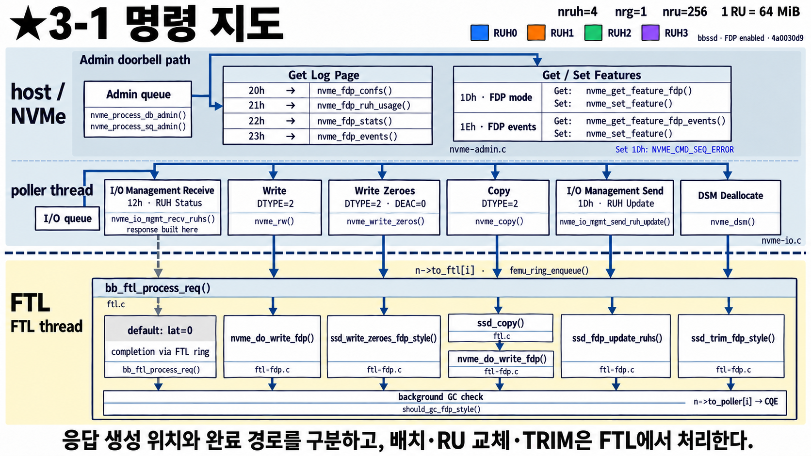
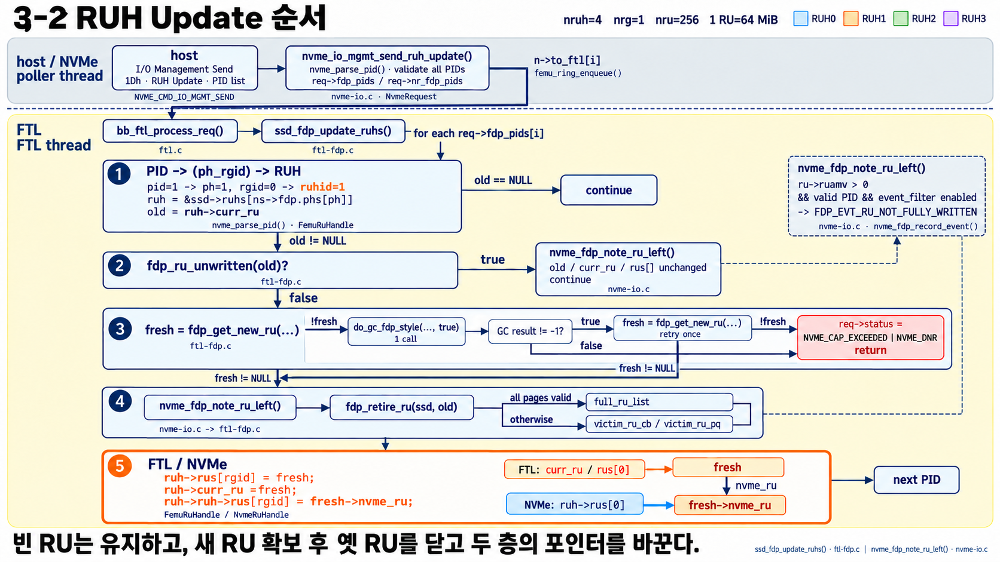

# FDP 3단계 — host와 SSD가 주고받는 FDP 명령

[2단계](32_FDP_2단계_PID에서_RU까지.md)에서는 write 명령 하나만 따라갔다.
이번에는 **FDP와 관련된 명령 전체**가 FEMU 안에서 어디로 가는지 한 장으로 보고,
그중 RUH Update를 자세히 본다.

---

## 3-1 명령 지도

**나:** 상자가 엄청 많아요…

**선배:** 가로로 **세 줄**만 구분하면 돼.

| 줄 | 누가 처리 | 어떤 명령 |
|---|---|---|
| 맨 위 (Admin doorbell path) | host가 **admin 큐**에 넣는 순간 바로 처리 | 설정·상태 조회: Get Log Page, Get/Set Features |
| 가운데 (poller thread) | 접수 창구 | **I/O 큐**로 오는 명령 전부 |
| 아래 (FTL thread) | 창고 일꾼 | 실제로 **RU를 건드리는** 일 |

**나:** 맨 위 줄부터요.

**선배:** **조회용 명령**이야. FTL까지 안 내려가고 그 자리에서 답해.

| 명령 | 번호 | 무엇을 알려 주나 | nvme-cli |
|---|---|---|---|
| Get Log Page | 20h | FDP 설정: RUH 몇 개, RU 크기 | `nvme fdp configs` |
| Get Log Page | 21h | RUH별 사용 현황(누가 쓰는 RUH인지) | `nvme fdp usage` |
| Get Log Page | 22h | 통계: host가 쓴 양(HBMW), NAND에 실제 쓴 양(MBMW), 지운 양(MBE) | `nvme fdp stats` |
| Get Log Page | 23h | event 기록(잘못된 PID 등) | `nvme fdp events` |
| Get/Set Features | 1Dh | FDP 켜짐 여부 | |
| Get/Set Features | 1Eh | 어떤 event를 기록할지 | |

**나:** Set Features 1Dh로 FDP를 껐다 켰다 할 수 있어요?

**선배:** 아니. 그림 오른쪽 위 파란 글씨처럼 **거부돼**(`NVME_CMD_SEQ_ERROR`).
FDP 모드는 namespace가 없을 때만 바꿀 수 있는데, FEMU는 실행할 때 namespace를 만들어 버리거든.
그래서 **FDP 설정은 QEMU 실행 옵션(1단계)으로만** 정해.

> 22h 통계로 **WAF = MBMW / HBMW** 를 계산할 수 있어. FDP가 효과 있는지 볼 때 제일 먼저 보는 숫자야.

---

**나:** 가운데 줄은 I/O 명령이네요.

**선배:** 응. 왼쪽부터:

| 명령 | 하는 일 | FTL에서 |
|---|---|---|
| I/O Mgmt Receive (12h) = **RUH Status** | PID 목록과 남은 공간 알려 주기 (2-4 그림) | **할 일 없음**(`lat=0`) |
| Write (DTYPE=2) | 묶음 지정해서 쓰기 | `nvme_do_write_fdp()` |
| Write Zeroes | 0으로 채우기 | `ssd_write_zeroes_fdp_style()` |
| Copy | SSD 안에서 복사 | `ssd_copy()` → `nvme_do_write_fdp()` |
| I/O Mgmt Send (1Dh) = **RUH Update** | RUH를 새 RU로 바꾸기 (3-2 그림) | `ssd_fdp_update_ruhs()` |
| DSM Deallocate | trim(이제 안 쓰는 데이터라고 알림) | `ssd_trim_fdp_style()` |

**나:** RUH Status는 FTL이 할 일이 없는데 왜 아래로 내려가요? (회색 점선)

**선배:** 좋은 질문. 답 내용은 창구(poller)에서 다 만들어. 그런데 FEMU는 **I/O 명령의 "완료" 알림을
항상 FTL을 한 번 거쳐서** 보내는 한 가지 길만 갖고 있어. 실패한 명령도 이 길로 가야 host에게 완료가 돌아가.
그래서 FTL은 할 일이 없는 명령을 `lat=0`(시간 0)으로 바로 돌려보내.

**나:** 맨 아래 `background GC check`는요?

**선배:** FTL이 **어떤 명령이든 하나 처리하고 나면** 끝에서 "GC 필요한가?"를 한 번 확인해. 4단계에서 볼 거야.
그다음 `to_poller` 벨트로 창구에 돌려보내고, 창구가 host에게 완료(CQE)를 보내.

> 그림 아래 한 줄: **응답을 어디서 만드는지**와 **완료가 어떤 길로 가는지**는 다를 수 있다.
> 배치(write)·RU 교체(RUH Update)·trim은 FTL에서 처리한다.

---

## 3-2 RUH Update: "이 묶음, 새 RU에서 다시 시작해"

**나:** RUH Update는 언제 써요?

**선배:** host가 "**이 RUH는 지금 RU를 닫고 새 RU로 넘어가**"라고 시키는 명령이야.
예를 들어 수명이 다른 데이터를 새로 쓰기 시작할 때, 이전 데이터와 같은 RU에 섞이지 않게 끊어 주는 용도야.
명령에는 PID 목록이 들어가고, PID마다 아래 과정을 반복해.

**나:** 번호대로 볼게요.

**선배:**

| 번호 | 하는 일 | 쉽게 말하면 |
|---|---|---|
| ① | PID → PH → RUH 찾기, 지금 RU(`old`) 확인 | 2단계와 같은 번역. RU가 아예 없으면 건너뜀 |
| ② | `old`가 **한 글자도 안 쓴 RU**인가? | 그렇다면 바꿀 이유가 없으니 **그대로 둠**(기록만 남김) |
| ③ | 새 RU(`fresh`) 받기 | 없으면 **강제 GC 1번** 돌리고 다시 시도. 그래도 없으면 **실패(CAP_EXCEEDED)** |
| ④ | 옛 RU 정리 | event 기록 후, 전부 살아 있는 데이터면 **full list**, 아니면 **victim queue**로 (4단계) |
| ⑤ | 포인터 교체 | **FTL 층** `curr_ru`·`rus[]`와 **NVMe 층** `rus[]`를 **둘 다** 새 RU로 (1-4 그림) |

**나:** 오른쪽 위 점선 상자의 `RU_NOT_FULLY_WRITTEN`은요?

**선배:** "RU를 **다 채우지 않고** 떠났다"는 event야. RU에 남은 공간이 있고(`ruamw > 0`),
PID가 올바르고, 그 event를 기록하도록 켜져 있을 때 남아. ②와 ④ 두 곳에서 이 확인을 해.

**나:** 우리 과제에서는요?

**선배:** 파일시스템이 "이제부터 다른 성격의 데이터"라는 걸 알 때 RUH Update로 RU를 끊어 줄 수 있어.
다만 RU를 덜 채우고 닫으면 공간이 낭비될 수 있으니 자주 쓰면 손해야. ③에서 GC가 돌 수도 있고.

---

## 한 줄 정리

> 조회 명령(Log Page, Features)은 admin 경로에서 바로 답하고, I/O 명령은 전부 FTL을 거쳐 완료된다.
> RU를 실제로 바꾸는 명령은 write, RUH Update, trim이고, RUH Update는 새 RU를 받고 옛 RU를 정리한 뒤 두 층의 포인터를 바꾼다.

## 확인 질문

1. `nvme fdp stats`로 WAF를 어떻게 계산하나?
2. RUH Status 명령은 FTL에서 무슨 일을 하나?
3. 한 번도 안 쓴 RU에 RUH Update를 보내면?
4. RUH Update 도중 free RU가 하나도 없으면?

답

1. MBMW(NAND에 실제 쓴 양) ÷ HBMW(host가 쓴 양).
2. 아무 일도 안 한다(`lat=0`). 완료를 보내기 위해 FTL을 거칠 뿐이다.
3. RU를 바꾸지 않는다. RU_NOT_FULLY_WRITTEN event만 남을 수 있다.
4. 강제 GC를 한 번 돌리고 다시 시도한다. 그래도 없으면 CAP_EXCEEDED로 실패한다.

## 나중에 코드에서 찾아보기

| 그림의 것 | 코드 |
|---|---|
| Log Page 20h~23h | [`nvme_fdp_confs()`](../../../nvme-admin.c#L2346) 등 [nvme-admin.c](../../../nvme-admin.c#L2915) `nvme_get_log()` |
| Set Features FDP | [`nvme_set_feature()`](../../../nvme-admin.c#L1501) |
| RUH Status | [`nvme_io_mgmt_recv_ruhs()`](../../../nvme-io.c#L1771) |
| I/O 명령이 FTL ring으로 가는 곳 | [nvme-io.c](../../../nvme-io.c#L369) |
| RUH Update | [`nvme_io_mgmt_send_ruh_update()`](../../../nvme-io.c#L1849) → [`ssd_fdp_update_ruhs()`](../../ftl-fdp.c#L1605) |
