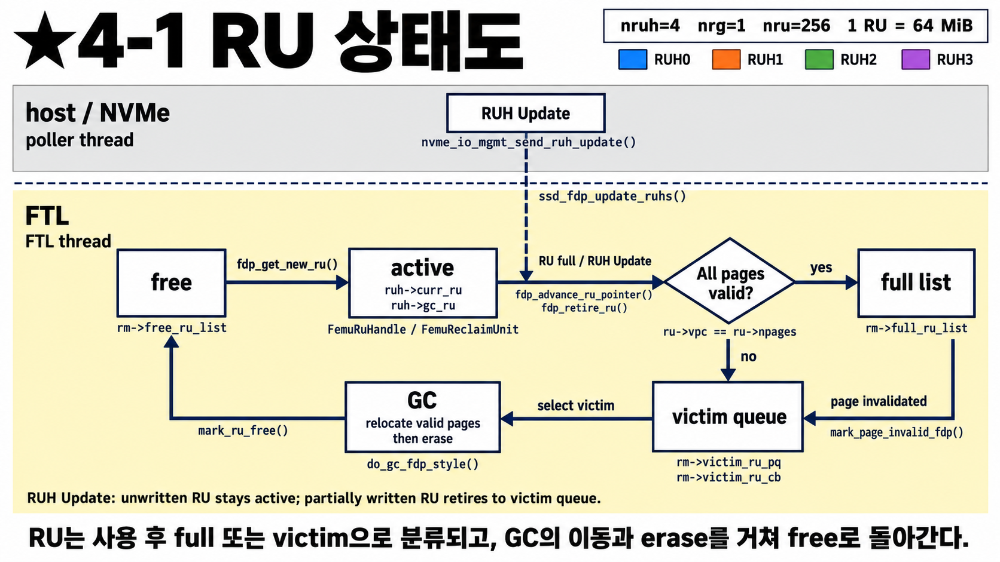
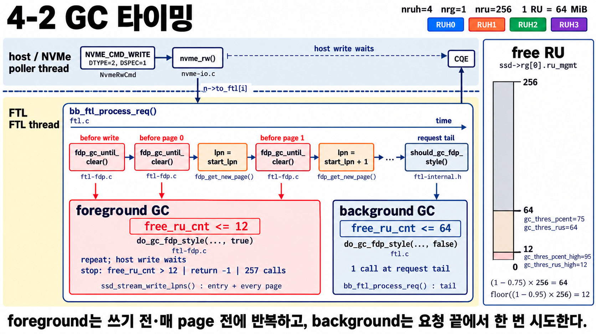

# FDP 4단계 — RU의 일생과 GC가 도는 시점

[2단계](32_FDP_2단계_PID에서_RU까지.md)에서 "RU가 차면 새 RU로 교체"라고만 했다.
이번에는 **RU 하나가 태어나서(free) 쓰이고, 버려지고, 다시 free가 되기까지**와
**GC가 언제 도는지**를 본다. 5단계 GC 정책을 보기 위한 준비 단계야.

---

## 4-1 RU 상태도

**나:** 상자가 다섯 개네요. 어디서 시작해요?

**선배:** 왼쪽 **free**부터 시계 방향으로 한 바퀴 돌면 돼.

| 상태 | 뜻 | 0단계 공책 비유 |
|---|---|---|
| **free** | 비어 있고 아무도 안 쓰는 RU | 새 공책 더미 |
| **active** | RUH가 지금 쓰고 있는 RU (`curr_ru`, 또는 GC용 `gc_ru`) | 펼쳐 놓고 쓰는 공책 |
| **full list** | 다 썼고, 안의 데이터가 **전부 아직 유효** | 다 썼는데 버릴 페이지가 없는 공책 |
| **victim queue** | 다 썼고, **버려진(invalid) page가 섞여 있음** → GC 후보 | 정리 대기함 |
| **GC** | 살아 있는 page만 다른 RU로 옮기고 RU를 지움 | 살아 있는 필기만 옮겨 적고 공책 재활용 |

**나:** 화살표를 순서대로 읽어 볼게요.

**선배:**

1. **free → active**: RUH가 RU가 필요하면 free에서 하나 꺼내 (`fdp_get_new_ru()`).
2. **active → 갈림길**: RU가 **가득 차거나**, host가 **RUH Update**(3-2)를 보내면 RU를 닫아.
   - 안의 page가 **전부 유효**하면 → **full list**
   - **하나라도 버려졌으면** → **victim queue**
3. **full list → victim queue**: full list에 있던 RU라도 나중에 그 데이터가 덮어쓰기나 trim으로
   **버려지면**(`mark_page_invalid_fdp()`) victim queue로 옮겨 가.
4. **victim queue → GC → free**: GC가 victim을 골라 살아 있는 page를 옮기고 지운 뒤 free로 돌려보내.

**나:** 덮어쓰기를 하면 왜 page가 버려져요?

**선배:** SSD는 제자리에 덮어쓸 수 없어서 **새 데이터는 다른 RU에 쓰고, 옛 page는 "버림"으로 표시**해(0단계).
그래서 덮어쓰기가 많을수록 RU들이 victim queue로 많이 가.

**나:** 맨 아래 영어 한 줄은요?

**선배:** RUH Update 때 **한 번도 안 쓴 RU는 그대로 active로 남고**, 조금이라도 쓴 RU는 닫혀서 위 규칙대로 간다는 뜻이야.
3-2 그림의 ②번과 같은 얘기야.

> FDP의 핵심이 여기서 보여. 같은 RUH에 **같이 버려질 데이터**를 모아 두면,
> victim RU 안의 page가 거의 다 버려진 상태라 GC가 옮길 게 적어.

---

## 4-2 GC는 언제 도나

**나:** GC가 두 종류네요. foreground, background.

**선배:** 응. **오른쪽 게이지**부터 보자. free RU 개수를 나타내고, 선이 두 개 있어.

| 선 | 값 | 계산 | 넘으면 |
|---|---|---|---|
| 64 | `gc_thres_rus` | (1 − 0.75) × 256 | **background GC** 시작 |
| 12 | `gc_thres_rus_high` | (1 − 0.95) × 256 (소수점 버림) | **foreground GC** 시작 |

free RU가 64개 이하로 줄면 "슬슬 정리하자", 12개 이하면 "급하다, 지금 당장"이야.

**나:** 가운데 시간축은요?

**선배:** write 명령 **하나**를 FTL이 처리하는 동안의 시간 순서야. 왼쪽에서 오른쪽으로.

1. **write 시작 전**: `fdp_gc_until_clear()`로 free RU가 12개 이하인지 확인 → 그렇다면 foreground GC
2. **page 0 쓰기 전**에 또 확인 → page 0 쓰기
3. **page 1 쓰기 전**에 또 확인 → page 1 쓰기 … (page마다 반복)
4. **요청 끝**: `should_gc_fdp_style()`로 free RU가 64개 이하인지 확인 → 그렇다면 background GC

| | foreground GC (빨강) | background GC (파랑) |
|---|---|---|
| 언제 | write 전, **매 page 전** | 요청 하나 끝날 때 |
| 조건 | free RU ≤ 12 | free RU ≤ 64 |
| 몇 번 | 12개를 넘을 때까지 **반복** (victim이 없거나 최대 257번이면 멈춤) | **한 번** |
| host 영향 | host write가 **기다림** → 지연 시간이 확 늘어남 | 이 요청의 완료 시간 계산에는 안 들어감 |

**나:** foreground가 왜 매 page 전에 확인해요?

**선배:** write 하나가 page를 아주 많이 쓸 수도 있잖아. 쓰는 도중에 free RU가 바닥나면 안 되니까
page마다 확인하는 거야. 그 대신 그때 GC가 돌면 **host는 그만큼 기다려야** 해.
그래서 foreground GC가 자주 돌면 tail latency(느린 요청)가 튀어.

**나:** background는 host를 안 기다리게 해요?

**선배:** 이 요청의 완료 시간에는 직접 안 더해져. 다만 GC도 NAND에 읽기·쓰기·지우기를 하니까,
**바로 뒤에 오는 요청들이 NAND가 바빠서 기다릴 수는 있어.**

> 우리 과제와 연결: hot/cold를 잘 나누면 victim RU 안이 거의 다 버려진 상태라 GC가 빨리 끝나고,
> free RU가 12 밑으로 잘 안 떨어져서 foreground GC(host가 기다리는 GC)가 줄어든다.

---

## 한 줄 정리

> RU는 free → active → (full list 또는 victim queue) → GC → free를 돈다.
> free RU가 64 이하면 요청 끝에 background GC 한 번, 12 이하면 write 전과 매 page 전에 foreground GC를 반복한다.

## 확인 질문

1. full list에 있던 RU가 victim queue로 가는 경우는?
2. free RU가 30개일 때 write를 하면 어떤 GC가 도나?
3. foreground GC가 많이 돌면 host 입장에서 무엇이 나빠지나?
4. hot/cold 분리가 GC를 줄이는 이유를 4-1 그림으로 설명하면?

답

1. 그 RU에 있던 데이터가 덮어쓰기나 trim으로 버려져 invalid page가 생길 때.
2. 64 이하라서 요청 끝에 background GC가 한 번 돈다. 12보다 크니 foreground GC는 안 돈다.
3. host write가 GC가 끝날 때까지 기다리므로 지연 시간(특히 tail latency)이 늘어난다.
4. 같이 버려질 데이터가 같은 RU에 모이면, victim RU 안이 거의 다 invalid라서 GC가 옮길 page가 적다.

## 나중에 코드에서 찾아보기

| 그림의 것 | 코드 |
|---|---|
| free → active | [`fdp_get_new_ru()`](../../ftl-fdp.c#L174) |
| RU 닫기 → full / victim | [`fdp_advance_ru_pointer()`](../../ftl-fdp.c#L326), `fdp_retire_ru()` |
| page가 버려질 때 | [`mark_page_invalid_fdp()`](../../ftl-fdp.c#L442) |
| GC 한 번 | [`do_gc_fdp_style()`](../../ftl-fdp.c#L1162) |
| foreground GC | [`fdp_gc_until_clear()`](../../ftl-fdp.c#L1323) |
| background GC | [`bb_ftl_process_req()` 끝](../../ftl.c#L674) |
| GC 기준값 계산 | [`femu_fdp_ssd_init_reclaim_group()`](../../ftl-fdp.c#L1824) |
