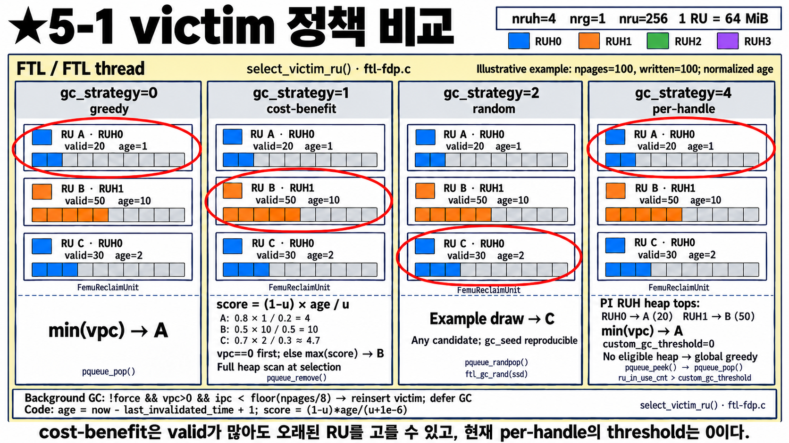
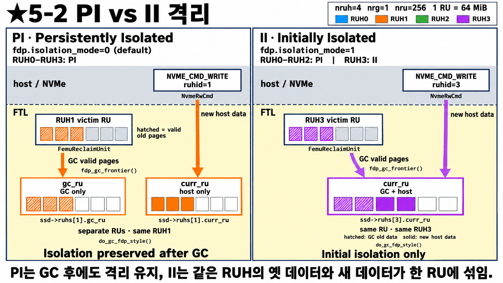
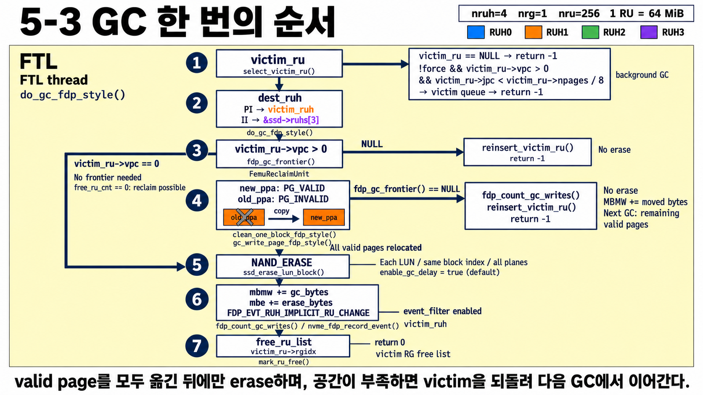

# FDP 5단계 — GC 정책: 누구를 고르고, 어디로 옮기나

[4단계](34_FDP_4단계_RU교체와_GC시점.md)에서 GC가 **언제** 도는지 봤다.
이번에는 GC가 **어떤 RU를 고르는지(5-1)**, 살아 있는 데이터를 **어디로 옮기는지(5-2)**,
GC 한 번이 **어떤 순서로** 진행되는지(5-3)를 본다. 박사님 과제의 "FEMU FDP의 GC 정책" 부분이다.

---

## 5-1 victim 정책 비교

**나:** 네 칸에 같은 RU 세 개가 반복돼 있네요.

**선배:** 응. **같은 후보 A, B, C**를 놓고 정책(`gc_strategy`)마다 누구를 고르는지 빨간 동그라미로 표시했어.
먼저 후보를 읽는 법부터.

| | 소속 | valid | age | 뜻 |
|---|---|---|---|---|
| A | RUH0 | 20 | 1 | 거의 다 버려짐, 최근에도 버려짐 |
| B | RUH1 | 50 | 10 | 반이 살아 있지만, **오랫동안 조용함** |
| C | RUH0 | 30 | 2 | 그 중간 |

- **valid**: RU 100칸 중 아직 살아 있는 page 수. GC 때 **옮겨야 하는 양**이야.
- **age**: 그 RU에서 마지막으로 page가 버려진 뒤 지난 시간. 오래 조용하면 **앞으로도 잘 안 바뀔(cold) 데이터**일 가능성이 커.

**나:** 정책별로 볼게요.

**선배:**

| `gc_strategy` | 이름 | 기준 | 고른 것 | 한마디 |
|---|---|---|---|---|
| 0 (기본) | greedy | valid가 **가장 적은** RU | **A** | "지금 당장 옮길 게 제일 적은 것" |
| 1 | cost-benefit | 점수 `(1−u) × age / u` 최대 | **B** | "얻는 공간 × 조용했던 시간 ÷ 옮길 양" |
| 2 | random | 후보 중 아무거나 | (예: C) | 비교 실험용 기준선. `gc_seed`로 같은 결과 재현 |
| 4 | per-handle | RUH마다 자기 후보 목록 1등끼리 비교 | **A** | 지금은 greedy와 거의 같음 |

**나:** cost-benefit은 왜 valid가 50이나 되는 B를 골라요?

**선배:** `u`는 RU 안에서 살아 있는 비율이야. 점수를 계산하면 A = 0.8 × 1 / 0.2 = **4**,
B = 0.5 × 10 / 0.5 = **10**, C ≈ **4.7**. B는 옮길 게 많지만 **오래 안 바뀐 데이터**라서,
지금 한 번 옮겨 두면 다시 GC할 일이 적다고 보는 거야. A는 지금은 싸지만 최근에도 계속 바뀌고 있으니
조금 기다리면 더 많이 버려져서 더 싸질 수 있고.
(그리고 page가 **전부** 버려진 RU가 있으면 점수 계산 없이 그걸 제일 먼저 골라.)

**나:** per-handle은 뭐가 달라요?

**선배:** 다른 정책은 RU 전체를 한 줄로 세우는데, per-handle은 **RUH마다 따로 줄을 세워**.
그림 오른쪽 아래처럼 RUH0 줄의 1등(A, valid 20)과 RUH1 줄의 1등(B, valid 50)을 비교해서 A를 골라.
원래는 RUH마다 "이 RUH는 RU를 몇 개 이상 쓰면 GC 대상"이라는 기준을 따로 둘 수 있는 구조인데,
**지금은 그 기준이 0이라** 결과가 greedy와 거의 같아. RUH별로 다른 GC 규칙을 넣고 싶을 때 손댈 자리야.

**나:** 맨 아래 영어 두 줄은요?

**선배:** 첫 줄: **background GC**는 고른 RU에서 버려진 page가 **1/8도 안 되면** "옮길 게 너무 많다"며
GC를 미루고 RU를 다시 후보 줄에 넣어. 정책과 상관없이 공통이야. foreground GC는 급하니까 안 미뤄.
둘째 줄: 실제 코드의 점수식이야. 0으로 나누지 않게 작은 값을 더한 것뿐이고 뜻은 같아.
age는 실제 시간(마이크로초)으로 재.

> 참고: `ftl.h`에는 10~13번 같은 다른 정책 이름도 남아 있지만, 설정할 수 있는 건 0, 1, 2, 4뿐이다.

---

## 5-2 PI vs II: GC로 옮긴 데이터는 어디로 가나

**나:** GC가 살아 있는 page를 옮길 때 아무 RU에나 넣으면 안 돼요?

**선배:** 그러면 FDP로 애써 나눈 게 GC 한 번에 섞여 버려. 그래서 RUH마다 **격리 종류**가 있어.

| 종류 | 이름 | GC로 옮긴 데이터가 가는 곳 | 설정 |
|---|---|---|---|
| **PI** | Persistently Isolated (계속 격리) | 같은 RUH의 **GC 전용 RU**(`gc_ru`) | `fdp.isolation_mode=0`(기본): RUH 4개 모두 PI |
| **II** | Initially Isolated (처음만 격리) | 마지막 RUH의 **지금 쓰는 RU**(`curr_ru`) | `fdp.isolation_mode=1`: RUH3만 II |

**나:** 왼쪽 PI부터요.

**선배:** RUH1에 RU가 **두 개** 열려 있지? `curr_ru`(host가 새 데이터를 쓰는 곳)와 `gc_ru`(GC만 쓰는 곳).
victim의 살아 있는 page(빗금)는 `gc_ru`로 가고, host의 새 데이터(색칠)는 `curr_ru`로 가.
**다른 RUH와도, 같은 RUH의 새 데이터와도 안 섞여.** 대신 RUH마다 RU를 하나 더 써야 해
(1-3 그림의 예약분 `gc_ru` 4개가 이거야).

**나:** 오른쪽 II는요?

**선배:** RUH3의 victim에서 옮긴 page(빗금)가 **RUH3가 지금 host 데이터를 쓰는 RU에 같이** 들어가.
GC에서 살아남은 옛 데이터와 방금 들어온 새 데이터가 한 RU에 섞이는 거야.
규격상 II는 "처음 쓸 때만 격리, GC 후에는 섞일 수 있음"이라는 뜻이야.
FEMU에서는 II가 마지막 RUH 하나뿐이라 **같은 RUH 안에서** 섞여.
(그림 위 host 명령의 `ruhid=1`, `ruhid=3`은 host가 보낸 PID가 그 RUH로 바뀐 결과라고 보면 돼.)

**나:** 우리 과제에는 어느 쪽이 맞아요?

**선배:** hot/cold를 끝까지 나눠 두려면 **PI**가 맞아. GC에서 살아남은 데이터는 대체로 오래 사는(cold) 데이터인데,
PI는 그걸 새로 들어오는 데이터와 따로 모아 줘.
재미있는 건 F2FS도 **"GC로 옮긴 데이터는 cold로 분류"** 한다는 점이야(6단계). 생각이 같아.

---

## 5-3 GC 한 번의 순서

**나:** 마지막으로 GC 한 번이 어떻게 진행되는지요.

**선배:** 위에서 아래로 ①~⑦이야.

| 번호 | 하는 일 | 실패하면 |
|---|---|---|
| ① | victim 고르기 (5-1) | 후보 없음 → 끝. background인데 버려진 page가 1/8 미만 → 되돌리고 끝 |
| ② | 옮길 곳의 RUH 정하기 (5-2): PI면 자기 RUH, II면 마지막 RUH(RUH3) | |
| ③ | 살아 있는 page가 있으면(`vpc > 0`) 받아 줄 RU(frontier) 확보 | free RU 없음 → victim 되돌리고 끝 (**erase 안 함**) |
| ④ | 살아 있는 page를 **전부** 옮김. 옮길 때마다 옛 page는 invalid로 | 도중에 공간 바닥 → 옮긴 만큼만 기록, victim 되돌림 → **다음 GC가 이어서** |
| ⑤ | 다 옮긴 뒤에야 각 LUN의 block을 **erase** | |
| ⑥ | 통계: MBMW += 옮긴 양, MBE += 지운 양. event 기록(RU가 저절로 바뀜) | |
| ⑦ | RU를 free list로 돌려보냄 | |

**나:** 왜 다 옮긴 다음에 지워요? 하나씩 옮기고 지우면 안 돼요?

**선배:** 중간에 공간이 바닥나서 멈출 수 있거든. 일부만 지운 상태로 멈추면 나중에 같은 RU를 다시 GC할 때
이미 지운 block을 또 지운 걸로 셀 수 있어. 그래서 **전부 옮기는 데 성공했을 때만** 지워.

**나:** 왼쪽에 길게 돌아가는 `vpc == 0` 화살표는요?

**선배:** RU 안이 **전부 버려진** 경우야. 옮길 게 없으니 받아 줄 RU도 필요 없어서 ③④를 건너뛰고 바로 지워.
free RU가 **0개**여도 할 수 있어서, 장치가 꽉 찼을 때 공간을 되찾는 길이 돼.
(host가 trim이나 덮어쓰기를 하면 이런 RU가 생겨.)

**나:** ⑥의 MBMW가 왜 중요해요?

**선배:** GC가 옮긴 양이 **MBMW(NAND에 실제로 쓴 양)** 에 더해지니까, GC가 많이 옮길수록
**WAF = MBMW / HBMW** 가 커져. FDP가 잘 되면 ④에서 옮길 page가 적어서 WAF가 1에 가까워져.
(그림 ①의 `jpc`는 `ipc`(invalid page 수)를 잘못 그린 거야.)

---

## 한 줄 정리

> GC는 `gc_strategy`로 victim을 고르고(greedy / cost-benefit / random / per-handle),
> PI면 같은 RUH의 `gc_ru`로, II면 마지막 RUH의 `curr_ru`로 옮긴 뒤, 전부 옮겼을 때만 erase한다.
> 옮긴 양은 MBMW에 쌓여 WAF를 올린다.

## 확인 질문

1. greedy와 cost-benefit이 다른 RU를 고르는 상황을 하나 들어 보라.
2. per-handle 정책이 지금 greedy와 거의 같은 이유는?
3. PI가 hot/cold 분리에 유리한 이유는? 대신 무엇을 더 쓰나?
4. GC 도중 옮길 공간이 바닥나면 어떻게 되나?
5. free RU가 0개인데도 GC가 RU를 되찾을 수 있는 경우는?

답

1. valid는 많지만 오래 안 바뀐 RU(B)와, valid는 적지만 최근까지 바뀐 RU(A)가 있을 때. greedy는 A, cost-benefit은 B.
2. RUH별 기준값(`custom_gc_threshold`)이 0이라, 결국 모든 PI RUH의 1등 중 valid 최소를 고르기 때문.
3. GC에서 살아남은 데이터를 새 host 데이터와 섞지 않고 RUH별로 따로 모은다. 대신 RUH마다 `gc_ru`를 하나 더 쓴다.
4. erase하지 않고 멈춘다. 옮긴 만큼만 통계에 넣고, victim은 다시 후보 줄로 돌아가 다음 GC가 이어서 한다.
5. victim의 page가 전부 버려진 경우(`vpc == 0`). 옮길 곳이 필요 없어서 바로 지운다.

## 해 보기

같은 fio 작업(예: `--fdp=1 --fdp_pli=0,1`로 hot/cold 두 갈래)을 `gc_strategy=0/1/2/4`로 바꿔 가며 돌리고,
`nvme fdp stats`의 MBMW/HBMW로 WAF를 비교한다. `isolation_mode=0/1`도 같은 방법으로 비교해 볼 수 있다.

## 나중에 코드에서 찾아보기

| 그림의 것 | 코드 |
|---|---|
| 정책별 victim 선택, background 미루기 | [`select_victim_ru()`](../../ftl-fdp.c#L678) |
| 정책 번호 정의 | [ftl.h](../../ftl.h#L395) |
| 목적지 결정과 GC 순서 ①~⑦ | [`do_gc_fdp_style()`](../../ftl-fdp.c#L1162) |
| PI/II별 받아 줄 RU | [`fdp_gc_frontier()`](../../ftl-fdp.c#L601) |
| page 하나 옮기기 | [`gc_write_page_fdp_style()`](../../ftl-fdp.c#L893) |
| 설명 문서 | [design/fdp.md](../../../docs/design/fdp.md) "Garbage collection" |
