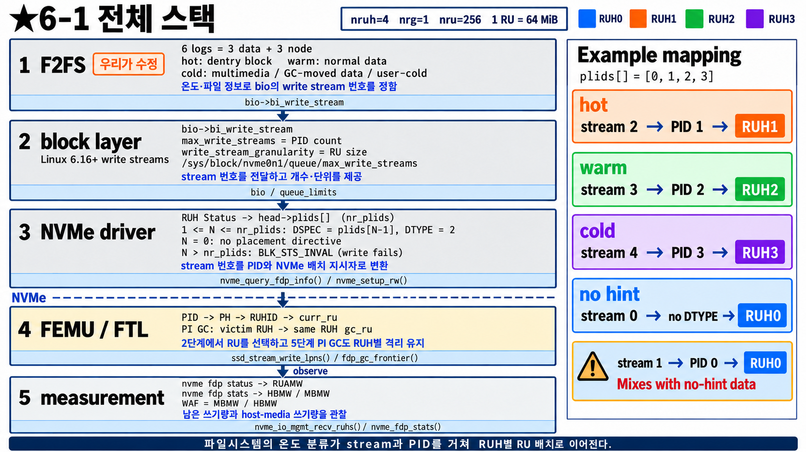

# FDP 6단계 — 파일시스템에서 RU까지, 전체 연결

0~5단계에서는 FEMU(SSD) 안쪽을 봤다. 이번에는 **우리 과제 전체 그림**:
파일시스템이 정한 데이터 성격이 커널을 지나 FEMU의 RU에 닿기까지를 한 장으로 본다.

---

## 6-1 전체 스택

**나:** 왼쪽에 다섯 층이 있네요. 위에서부터요.

**선배:** 위 세 층은 **host(게스트 Linux 커널)**, 점선 아래 두 층은 **SSD(FEMU)와 측정**이야.

| 층 | 하는 일 | 쉽게 말하면 |
|---|---|---|
| ① F2FS | 데이터 온도(hot/warm/cold)를 보고 bio에 **write stream 번호**를 붙임 | "이 데이터는 몇 번 갈래" — **우리가 수정할 곳** |
| ② block layer | stream 번호를 아래로 전달. "stream이 몇 개까지 되는지", "RU 크기"를 알려 줌 | 전달자 |
| ③ NVMe 드라이버 | stream 번호를 **PID**로 바꿔 write 명령에 DTYPE=2, DSPEC=PID로 넣음 | 번역기 |
| ④ FEMU | PID → PH → RUHID → RU (2단계), PI GC로 격리 유지 (5단계) | 0~5단계 내용 |
| ⑤ 측정 | `nvme fdp status`(RUAMW), `nvme fdp stats`(HBMW/MBMW) → WAF | 효과 확인 |

---

**나:** ① F2FS는 원래 데이터를 어떻게 나눠요?

**선배:** F2FS는 데이터를 쓸 곳(log)을 **6개** 갖고 있어: node 3개 + data 3개. data 쪽은 이렇게 나눠.

| 온도 | 들어가는 데이터 |
|---|---|
| hot | 디렉터리 항목(dentry) block |
| warm | 일반 파일 데이터 |
| cold | 멀티미디어 파일, GC로 옮긴 데이터, 사용자가 cold로 지정한 파일 |

**나:** 그럼 일반 파일은 다 warm이에요?

**선배:** 그게 박사님이 말한 "F2FS의 hotness 식별이 FDP용으로는 약하다"는 부분이야.
**대부분의 일반 파일 데이터가 warm 하나로 묶이면**, RUH가 4개 있어도 사실상 한 갈래로 몰려.
그래서 우리 과제는 **파일 I/O 정보로 더 잘게, 더 정확하게 나눈 stream 번호**를 만들어 내려보내는 거야.

---

**나:** ② block layer는 뭘 해 줘요?

**선배:** Linux **6.16**(2025년 7월)부터 block layer에 **write stream**이 생겼어.

| 이름 | 뜻 |
|---|---|
| `bio->bi_write_stream` | 이 bio(쓰기 요청)의 stream 번호 |
| `max_write_streams` | 쓸 수 있는 stream 개수 = SSD의 PID 개수. `/sys/block/nvme0n1/queue/max_write_streams`로 확인 |
| `write_stream_granularity` | 같이 지우는 단위 = RU 크기 |

6.16에서 들어간 건 응용 프로그램이 io_uring으로 **블록 장치에 직접** stream을 지정하는 길이야.
**파일시스템이 bio에 stream 번호를 채우는 부분**이 우리가 만들 부분이야.

---

**나:** ③ NVMe 드라이버의 번역은요?

**선배:** 두 단계야.

1. **장치를 처음 붙일 때** — RUH Status 명령(2-4)으로 PID 목록을 받아 `plids[]`에 저장해 둬.
   FEMU(`nruh=4`)라면 `plids[] = [0, 1, 2, 3]`, 개수 `nr_plids = 4`.
2. **write마다** — stream 번호 N을 보고:

| N | 결과 |
|---|---|
| 0 | 배치 정보 **안 넣음** (DTYPE 없음) → FEMU에서 RUH 0 (2-3) |
| 1 ~ `nr_plids` | DSPEC = `plids[N−1]`, DTYPE = 2 |
| `nr_plids`보다 큼 | **쓰기 실패** (`BLK_STS_INVAL`) |

**나:** 오른쪽 예시 표가 그거네요.

**선배:** 응. hot → stream 2 → PID 1 → RUH1, warm → stream 3 → PID 2 → RUH2,
cold → stream 4 → PID 3 → RUH3, 힌트 없음 → stream 0 → RUH0.

**나:** 맨 아래 경고(⚠)는요?

**선배:** **stream 1은 `plids[0]` = PID 0 → RUH 0**이야. 그런데 힌트 없는 데이터(stream 0)도 RUH 0으로 가지?
그래서 stream 1을 쓰면 **힌트 없는 데이터와 섞여.** 그래서 예시에서는 일부러 stream 2부터 썼어.
설계할 때 "RUH 0은 분류 안 된 데이터용"으로 남겨 두는 것도 방법이야.

**나:** FEMU는 틀린 PID를 받아도 RUH 0으로 보내 줬는데, 드라이버는 실패시켜요?

**선배:** 응, 층마다 달라. FEMU(SSD)는 받은 PID가 틀리면 RUH 0으로 보내고 event만 남겨(2-3).
하지만 커널 드라이버는 **SSD에 보내기 전에** stream 번호가 범위를 넘으면 쓰기 자체를 거절해.
그래서 파일시스템은 **`max_write_streams`를 보고 그 안에서만** stream 번호를 골라야 해.

---

**나:** ④ ⑤는 지금까지 배운 거죠?

**선배:** 맞아. ④는 2단계(PID → RU)와 5단계(PI GC), ⑤는 3단계의 Log Page 22h야.
우리가 커널을 고친 뒤 확인하는 순서는 이렇게 하면 돼.

| 확인 | 어떻게 | 기대 |
|---|---|---|
| stream 개수 | `cat /sys/block/nvme0n1/queue/max_write_streams` | 4 (`fdp.nruh=4`) |
| 갈래별로 들어가나 | `nvme fdp status /dev/nvme0n1`을 쓰기 전후로 비교 | 데이터 성격별로 다른 PID의 RUAMW가 줄어듦 |
| FEMU 안에서 | QEMU를 `FEMU_FDP_DEBUG=1`로 실행 | write마다 PID/RUH trace |
| 효과 | `nvme fdp stats`로 MBMW / HBMW | 수정 전보다 WAF가 낮아짐 |

---

## 한 줄 정리

> 파일시스템이 bio에 stream 번호를 붙이면(우리가 수정) → block layer가 전달하고 →
> NVMe 드라이버가 `plids[N−1]`을 DSPEC에 넣고 → FEMU가 PID → RUH → RU로 배치하고 PI GC로 격리를 지킨다.
> 효과는 WAF = MBMW / HBMW로 본다.

## 확인 질문

1. F2FS 기본 분류에서 FDP의 RUH를 다 못 쓰는 이유는?
2. stream 3으로 쓰면 FEMU의 어느 RUH로 가나? (`plids[] = [0,1,2,3]`)
3. stream 1을 쓰면 무엇이 문제인가?
4. stream 5로 쓰면? (`nr_plids = 4`)
5. class가 RUH 수보다 많으면 어느 층에서 합쳐야 하나?

답

1. 대부분의 일반 파일 데이터가 warm 하나로 묶여서 사실상 한 갈래로 몰린다.
2. `plids[2]` = PID 2 → RUH 2.
3. PID 0 → RUH 0이라서 힌트 없는 데이터(stream 0)와 같은 RUH에 섞인다.
4. NVMe 드라이버가 SSD에 보내기 전에 거절한다(`BLK_STS_INVAL`, 쓰기 실패).
5. stream 번호를 정하는 파일시스템 층. 드라이버는 `max_write_streams`를 넘는 번호를 받아 주지 않는다.

## 출처 (커널 쪽)

- 패치 묶음 "Block write streams with nvme fdp" v16 (2025-05, Jens Axboe 적용): [cover letter](https://lists.infradead.org/pipermail/linux-nvme/2025-May/056053.html)
- PID 목록과 `max_write_streams` 등록: [10/11 nvme: register fdp parameters with the block layer](https://lists.infradead.org/pipermail/linux-nvme/2025-May/056061.html)
- stream → `plids[N−1]` → DSPEC: [11/11 nvme: use fdp streams if write stream is provided](https://lists.infradead.org/pipermail/linux-nvme/2025-May/056060.html)
- Linux 6.16에 포함: [Phoronix](https://www.phoronix.com/news/Linux-6.16-Block-IO_uring)
- F2FS 6 log 분류: [Wikipedia F2FS](https://en.wikipedia.org/wiki/F2FS)

커널 소스는 이 저장소에 없다. 실제로 쓸 게스트 커널 버전의 `drivers/nvme/host/core.c`(`nvme_setup_rw()`, `nvme_query_fdp_info()`)와
`fs/f2fs/`에서 한 번 더 확인할 것.
